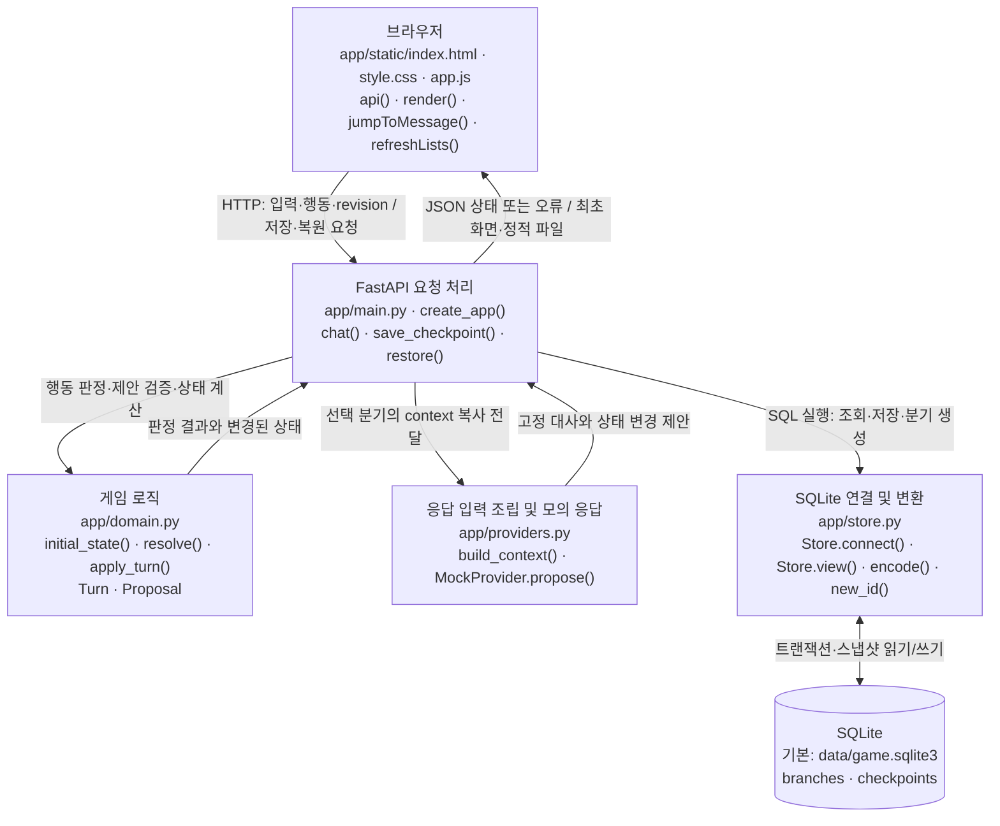
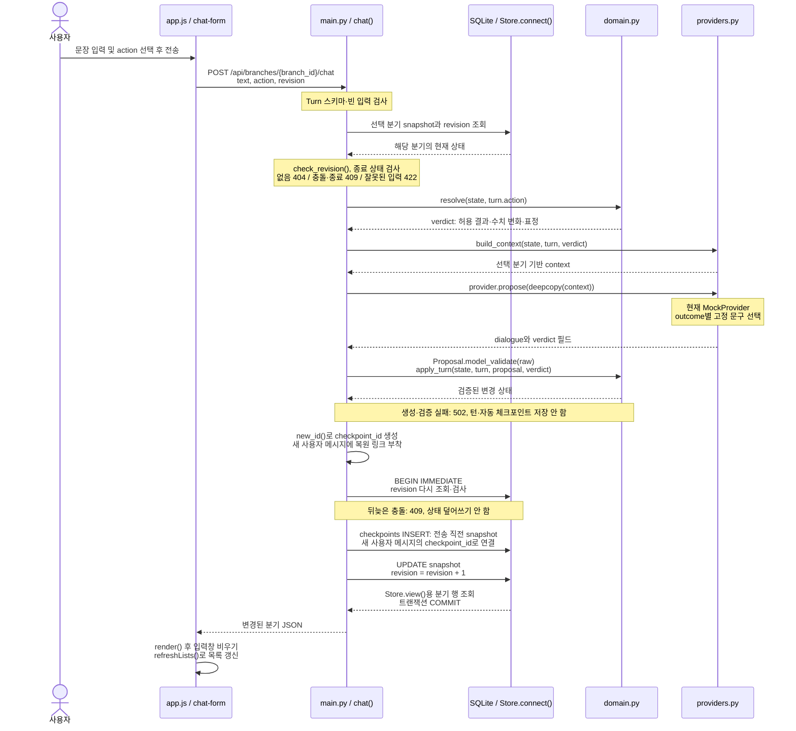
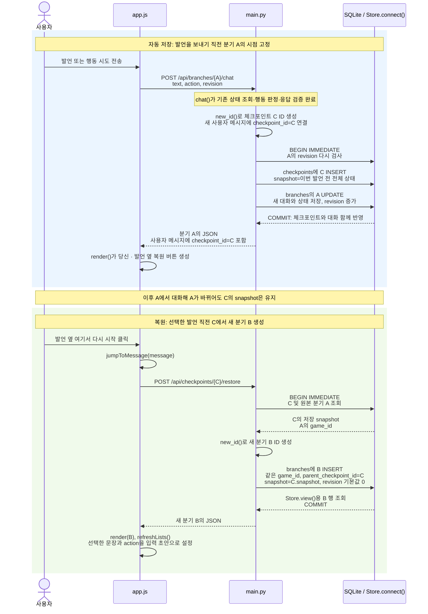

> 구조 스냅샷 **002 · message-jump** · 보존일: **2026-10-21 (Asia/Seoul)**
> 발언별 자동 체크포인트와 메시지 옆 새 분기 복원. 실제 LLM 미연결, 모델명 없음.
> 보존 시점의 최신 구조 본문을 보관한다. 이 파일은 덮어쓰지 않으며 상대 링크만 위치에 맞게 조정했다.

# 현재 코드로 보는 캐릭터 채팅 구조

확인일: 2026-10-21. `app/`의 Python 코드, 브라우저 JavaScript, SQLite 스키마를 직접 읽고 작성했다. 이번 단계에서는 발언별 자동 저장과 대화 옆 복원 버튼으로 게임 동작을 변경했고, 그 코드를 기준으로 문서를 갱신했다.

문서 관리 기준일: 2026-10-21 (Asia/Seoul). 현재 단계는 **002 · message-jump**이다. 이 파일은 앞으로 실제 코드에 맞춰 갱신하는 최신 문서다. 최초 모의 응답 구조는 [001-mock 스냅샷](001-mock.md)에 보존했고, 작업별 변경 유형·이유·검증·남은 문제는 [변경 기록](../changes.md)에 남긴다. 구조 변경 전후에는 [프로젝트 지침](../../AGENTS.md)에 따라 스냅샷을 확인·추가한다. 현재 구조는 [002-message-jump 스냅샷](002-message-jump.md)으로 보존한다. 001 이후 발언별 자동 체크포인트와 메시지 옆 복원 버튼이 추가됐고, 별도 수동 저장 패널은 제거됐다.

## 1. 현재 응답 생성기

**현재는 모의 응답이다. 실제 LLM은 사용하지 않으며, 연결된 모델명은 없다.**

| 확인 항목 | 실제 구현과 근거 |
| --- | --- |
| 기본 생성기 선택 | [app/main.py](../../app/main.py)의 `create_app()`에서 `app.state.provider = provider or MockProvider()` |
| 기본 실행 진입점 | 같은 파일의 `app = create_app()`은 별도 provider를 전달하지 않으므로 `MockProvider`를 선택 |
| 응답 반환 | [app/providers.py](../../app/providers.py)의 `MockProvider.propose(context)` |
| 대사 선택 방식 | `context["verdict"]["outcome"]`으로 `lines` 딕셔너리의 고정 문구를 선택 |
| 상태 변경 제안 | 서버의 `verdict`를 그대로 복사하여 대사와 함께 반환 |
| 실제 LLM / 모델명 | **연결 안 됨 / 없음** |
| Ollama 호출 | 현재 `app/`에 Ollama 호출 코드나 모델명 설정이 없음 |
| 실행 중 생성기 확인 | `GET /api/health` → `health()`가 실제 provider의 클래스명을 반환 |

기본 실행이라면 health 응답은 `{"status":"ok","provider":"MockProvider"}`이다. 이 문서를 작성하면서 실행 중인 별도 서버의 health를 조회한 것은 아니다. `create_app(provider=...)`로 다른 객체를 주입할 수 있으므로, 별도 실행 인스턴스의 생성기는 health로 확인할 수 있다.

현재 mock은 사용자 문장·대화 기록을 의미적으로 해석하지 않는다. 예를 들어 발언 모드의 “안녕하세요”와 “나는 왕이다”는 같은 고정 대사를 받는다. 사건 결과는 사용자가 선택한 `action`과 현재 사건 상태로 서버가 결정한다.

## 2. 전체 구조 — 현재 구현

**쉬운 설명:** 브라우저는 입력을 보내고 결과를 그리는 화면이다. FastAPI는 요청을 받아 게임 규칙과 응답 생성기를 호출한다. 게임 로직이 허용되는 행동 결과를 결정하고, 모의 응답기는 그 결과에 맞는 문구를 돌려준다. 검증을 통과하면 전송 직전 자동 체크포인트와 변경된 상태를 같은 트랜잭션으로 SQLite에 저장한다.

게임 로직·응답 생성기는 같은 Python 앱 안의 모듈이다. 각각 별도 서버가 아니다. 현재 생성기에는 외부 모델 통신이 없으며 GPU도 사용하지 않는다. SQL 문장은 주로 `main.py`에 있고, `store.py`는 연결·트랜잭션·JSON 변환을 담당한다. 기본 DB 경로는 `CHARACTER_CHAT_DB` 환경변수 또는 `create_app(db_path=...)` 인자로 바꿀 수 있다.

### 파일과 함수 연결

| 구성요소 | 실제 파일 | 주요 함수·클래스와 역할 |
| --- | --- | --- |
| 화면 구조·스타일 | [index.html](../../app/static/index.html), [style.css](../../app/static/style.css) | 입력창, 행동 선택, 관계 수치, 분기 선택. 발언별 복원 버튼은 JavaScript가 생성한다. 이 두 파일에는 주요 처리 함수가 없음 |
| 브라우저 동작 | [app.js](../../app/static/app.js) | `api()` HTTP 요청, `run()` 처리 중 잠금과 오류 표시, `render()` 상태와 발언별 복원 버튼 표시, `jumpToMessage()` 복원 후 입력 초안 설정, `refreshLists()` 분기 목록 조회, `controls()` 입력 활성/비활성 |
| 화면 이벤트 | 같은 `app.js` | `chat-form`의 `submit`, `new-game`·`load-branch`와 발언별 복원 버튼의 `click`에 익명 핸들러를 등록. 복원 버튼은 `jumpToMessage()`를 호출한다. 별도의 이름 있는 전송 함수는 없음 |
| API와 흐름 제어 | [main.py](../../app/main.py) | `create_app()`, `chat()` 자동 체크포인트와 턴의 원자적 저장, `new_game()`, `save_checkpoint()` 기존 수동 저장 API, `restore()`, `get_branch()`, `branches()`, `checkpoints()`, `health()` |
| 요청·응답 형식 | [domain.py](../../app/domain.py), [main.py](../../app/main.py) | `Turn` 입력 검증, `Proposal` 제안 검증, `CheckpointRequest` 저장 요청 검증 |
| 캐릭터와 게임 규칙 | [domain.py](../../app/domain.py) | `CONFIG`, `initial_state()` 초기 상태, `resolve()` 행동 결과, `apply_turn()` 제안 대조·수치·사건·대화·기억·요약 갱신 |
| 응답 생성 경계 | [providers.py](../../app/providers.py) | `ResponseProvider` 호출 형태 정의, `MockProvider.propose()` 고정 응답, `build_context()` 선택 분기의 생성기 입력 조립 및 UI용 `checkpoint_id` 제외 |
| 저장 연결 | [store.py](../../app/store.py) | `Store.__init__()` 테이블 생성, `Store.connect(write=True)` 쓰기 트랜잭션, `Store.view()` API용 분기 객체, `encode()` JSON 직렬화, `new_id()` UUID 생성 |

`main.py`의 라우트 함수와 `branch()`·`check_revision()`은 `create_app()` 내부에 정의되어 있다. 표의 함수명은 코드에 있는 이름이다.

## 3. 메시지 한 번 전송 시 처리 순서

**쉬운 설명:** 사용자의 문장을 바로 사실로 저장하는 것이 아니라, 선택된 행동에 적용할 규칙을 먼저 정한다. mock은 그 판정에 맞는 대사와 수치를 제안한다. 서버는 제안의 형식과 내용이 허용된 판정과 같은지 검사한 뒤, 대화·상태와 전송 직전 체크포인트를 같은 트랜잭션으로 저장한다. 사용자 메시지의 `checkpoint_id`가 그 지점으로 돌아가는 버튼의 대상이다. 생성·검증 실패나 revision 충돌에서는 턴도 자동 체크포인트도 저장하지 않고, DB 쓰기 도중 실패하면 둘 다 롤백한다.

`revision`은 “이 상태가 몇 번 갱신됐는가”를 나타내는 충돌 검사 번호다. 처음 읽을 때와 저장 직전에 두 번 검사한다. 같은 이전 상태에서 두 요청이 동시에 출발해도 먼저 저장한 결과를 뒤의 요청이 덮어쓰지 못하게 한다. 응답 생성 중에는 쓰기 트랜잭션을 열어 두지 않는다.

그림은 정상 경로를 이어 그렸으며 오류 시에는 해당 지점에서 반환한다. 브라우저는 반환된 오류 메시지를 `run()`에서 표시한다.

### 현재 행동 판정

| `action` | `resolve()`의 결과 | 신뢰 변화 | 경계 변화 | 종료 |
| --- | --- | --- | --- | --- |
| `speak` | `conversation` | 0 | 0 | 아니오 |
| `request_access` | `access_refused` | 0 | +5 | 아니오 |
| `force_access`, 이전 시도 0회 | `warning` | -15 | +25 | 아니오 |
| `force_access`, 이전 시도 1회 이상 | `expelled` | -15 | +25 | 예 |
| `leave` | `left` | 0 | 0 | 예 |

수치는 `apply_turn()`에서 0–100으로 제한한다. 강제 접근 시도 횟수는 서버가 증가시킨다. 이 버전에는 열람 성공이나 신뢰 상승 경로가 없다. 문장에 “강제로 연다”라고 써도 `action=speak`이면 발언으로 처리한다. 자연어 행동 추론은 구현되지 않았다.

`Proposal`은 필드·타입·범위를 검사하고, `apply_turn()`은 표정·수치 변화·결과를 서버 판정과 대조한다. 대사가 세계관과 의미상 모순되는지를 판독하는 검사는 현재 없다. 핵심 설정이 상태에서 바뀌지 않는 것과 향후 LLM 대사의 의미적 일관성은 별도 문제다.

## 4. 발언별 자동 체크포인트와 새 분기 복원

**쉬운 설명:** 매번 발언을 정상 전송하면 그 발언을 보내기 직전의 상태 C를 자동으로 보관한다. “당신 · 발언” 옆 **↶ 여기서 다시 시작**을 누르면 C로부터 새 분기 B를 만든다. 선택한 발언과 그 뒤의 대화·사건은 B에 없고, 원래 분기 A에는 그대로 남는다. 선택한 문장은 입력창에 다시 넣어 주므로 수정 후 전송할 수 있다. 종료된 분기에서도 버튼을 사용할 수 있다.

복원 중 A에서 가져오는 것은 같은 게임으로 묶기 위한 `game_id`다. 실제 대화·기억·사건은 A의 최신 상태가 아니라 **C에 저장한 snapshot**에서 가져온다. 복원 API는 응답 생성기를 호출하거나 선택한 발언을 자동 재전송하지 않는다. 입력 초안은 다시 전송해야 서버에 반영된다.

자동 저장은 `chat()`, 복원은 기존 `restore()`가 담당한다. DB 테이블·컬럼은 변경하지 않았다. `checkpoints`의 스냅샷을 재사용하되, 사용자 메시지 JSON에 `checkpoint_id`를 추가한다. 구조를 바꾸기 전의 발언에는 자동 저장 지점이 없으므로 복원 버튼을 비활성화하고 사유를 툴팁으로 표시한다. 과거 상태를 문장에서 추측하거나 대화만 잘라 복원하지 않는다. 업데이트 이후 새로 성공한 턴부터 자동 저장된다.

별도 수동 저장·체크포인트 목록 패널은 UI에서 제거했다. 과거 체크포인트를 삭제하지 않았고 `save_checkpoint()`·`checkpoints()` API는 호환성을 위해 남아 있다. 기존 수동 체크포인트 조회·복원이 필요하면 `/docs`의 API를 사용할 수 있다. `refreshLists()`는 이제 보존된 분기 목록만 조회한다.

복원은 `Store.connect(write=True)`로 처리하며 오류가 나면 롤백된다. 대상 분기나 체크포인트가 없으면 404다. 자동 저장과 대화 반영은 한 트랜잭션으로 처리하므로 실패한 턴의 복원 지점만 남지 않는다. 이전 발언을 포함한 분기를 복원해도 그 발언에 연결된 기존 `checkpoint_id`는 유지되어 다시 사용할 수 있다.

### 실제로 함께 저장하는 내용

| 스냅샷 필드 | 의미 |
| --- | --- |
| `messages` | 저장 시점까지의 사용자 발언·행동 선택과 캐릭터 대사. 새 사용자 메시지는 전송 직전 상태의 `checkpoint_id`도 포함 |
| `summary`, `memories` | 확정 상태로 만든 요약, 서버가 기록한 사건 기억 |
| `trust`, `guard`, `expression` | 관계 수치와 표정 |
| `events`, `ended` | 강제 접근 횟수·기록 봉인·종료 사유 및 종료 여부 |
| `config_version`, `config` | 설정 버전과 해당 핵심 설정 본문 |

이 내용은 각각 별도 테이블이 아니라 JSON 문자열 하나인 `snapshot`에 함께 저장된다. `branches`에는 각 분기의 현재 snapshot, `checkpoints`에는 저장 당시 snapshot이 있다. 현재 API에는 체크포인트를 수정하는 경로가 없다.

복원 분기의 revision은 0으로 시작하지만 대화 기록이 비워지는 것은 아니다. UI의 “턴” 표시는 이 revision을 사용하므로 복원 뒤 보이는 숫자는 전체 대화 횟수와 다를 수 있다.

### 미래 정보가 입력에 섞이지 않는 경로

복원 뒤 `chat()`은 새 분기 B의 snapshot만 읽는다. `build_context()`는 그 상태의 설정, 신뢰·경계·사건·요약·기억, 대화 전체와 이번 입력·판정을 묶는다. 다른 분기, 원본 A의 최신 대화, 체크포인트 목록은 읽지 않는다.

`refreshLists()`는 UI 표시를 위해 분기 메타데이터만 조회한다. 목록은 provider 입력에 넣지 않고, `build_context()`는 각 대화의 UI용 `checkpoint_id`도 제거한다. 현재 mock이 입력 내용을 실제 추론에 사용하는 것은 아니지만, 입력을 분리하는 코드는 이미 존재한다.

저장된 대사는 그대로 복원한다. 향후 실제 LLM이 복원 이후 새로 만들 문장까지 동일하게 재현하는 기능은 현재 구현되어 있지 않다.

자동 체크포인트는 전체 상태를 매 턴 복사하므로 긴 대화에서는 저장량이 빠르게 늘어난다. 보존·정리 정책은 아직 없다.

관련 코드 검증은 [tests/test_game.py](../../tests/test_game.py)의 `test_restore_exact_snapshot_no_future_context_and_preserve_branch()`, `test_checkpoint_includes_config_snapshot()`, `test_invalid_provider_output_atomic()`, `test_concurrent_turns_only_commit_once()`, `test_restart_persistence()`에 있다. 이번 변경 후 기존 검증과 발언별 정확 복원·미래 정보 격리·재시작 유지·구버전 데이터·DB 오류 롤백 검증을 합쳐 27개 테스트가 통과했다. Node의 JavaScript 구문 검사와 실제 `app.js`를 DOM 대역에서 실행한 점검도 통과했다. 후자는 종료 후 점프·구버전 버튼 비활성 유지·문장/행동 초안 복원·자동 재전송 방지를 확인했으며 실제 브라우저 검증은 아니다. 기존 Starlette/httpx 사용 중단 예정 경고 1개는 남아 있다. 실제 브라우저 클릭·레이아웃과 VS Code 다이어그램 렌더링은 직접 확인하지 못했다.

## 5. 향후 Ollama 연결 계획 — 미구현

앞의 세 그림은 현재 코드만 나타낸다. 아래는 교체 지점과 다음 작업을 설명하는 계획이며, 지금 실행되는 기능이 아니다.

| 항목 | 현재 코드 | 향후 계획 |
| --- | --- | --- |
| 생성기 | `MockProvider.propose(context)` | `ResponseProvider`와 같은 호출 형태의 Ollama용 adapter 추가. README의 예정 명칭은 `OllamaProvider`이며 아직 클래스는 없음 |
| 연결 지점 | `create_app(provider=...)`로 객체 주입 가능 | 새 adapter를 이 지점에서 선택하도록 구성 |
| 실제 통신·모델 | 외부 호출 없음, 모델명 없음 | 사용자 WSL의 Ollama 접근·GPU 상태를 확인한 뒤 모델과 호출 설정 결정 |
| 출력 처리 | Python 딕셔너리를 `Proposal.model_validate()`에 전달 | 모델 응답을 파싱하여 같은 제안 구조로 변환하고 검증 경로 유지 |
| 실패 처리 | provider 예외·잘못된 제안을 502로 거부, 턴 저장 안 함 | 통신 타임아웃·잘못된 JSON·설정 위반 대사 평가 등을 추가 설계하고 검증 |

현재 코드에는 Ollama 서버 주소·모델명·타임아웃·재시도·스트리밍 설정이 없다. 모델명은 아직 정하지 않았다. 모델 연결 뒤에도 상태 변경과 종료 적용은 서버 책임으로 유지하는 것이 계획이다. 이번 작업에서는 이 계획을 구현하거나 모델을 설치하지 않았다.

## 6. VS Code에서 그림으로 보기

1. VS Code에서 이 프로젝트를 열고 `docs/architecture.md`를 선택한다.
2. **Ctrl+Shift+V**로 Markdown 미리보기를 연다. 코드와 그림을 나란히 보려면 **Ctrl+K를 누른 뒤 V**를 누른다.
3. 또는 **Ctrl+Shift+P**에서 `Markdown: Open Preview to the Side`를 실행한다.

VS Code 공식 문서에 따르면 기본 Markdown 미리보기는 `mermaid` 코드 블록을 그림으로 렌더링한다. [공식 Markdown 안내](https://code.visualstudio.com/docs/languages/markdown#markdown-preview)

이번에 접근한 환경의 VS Code 서버 `package.json` 버전은 **1.142.0**이고, `extensions/mermaid-markdown-features` 폴더가 존재한다. 따라서 먼저 **추가 설치 없이 기본 미리보기**를 사용한다. 내장 `Mermaid Markdown Features`는 VS Code 1.121에 통합되었다. [공식 1.121 변경 사항](https://code.visualstudio.com/updates/v1_121/)

이 확인은 도구 환경의 서버 파일 기준이며, 사용자가 보는 VS Code 클라이언트의 정확한 버전·내장 확장 활성 상태·최종 그림 렌더링을 직접 확인한 것은 아니다.

그림 대신 코드가 보이면 다음을 확인한다.

- 일반 텍스트 편집기 대신 **Markdown 미리보기**를 열었는지 확인한다.
- 확장 화면에서 `@builtin mermaid`를 검색해 `Mermaid Markdown Features`가 비활성인지 확인한다.
- 사용자 클라이언트가 내장 지원 이전 버전이라면 추가 확장 또는 업데이트가 필요할 수 있다. 그 경우에는 먼저 현재 버전과 필요한 변경을 설명한 뒤 설치 여부를 결정한다.

**이번 작업에서는 확장 설치·활성화 변경·VS Code 업데이트를 수행하지 않았다.** 미리보기 안내는 공식 문서와 설치 파일 확인 기준이며, 실제 화면의 렌더링 검증은 하지 못했다.
