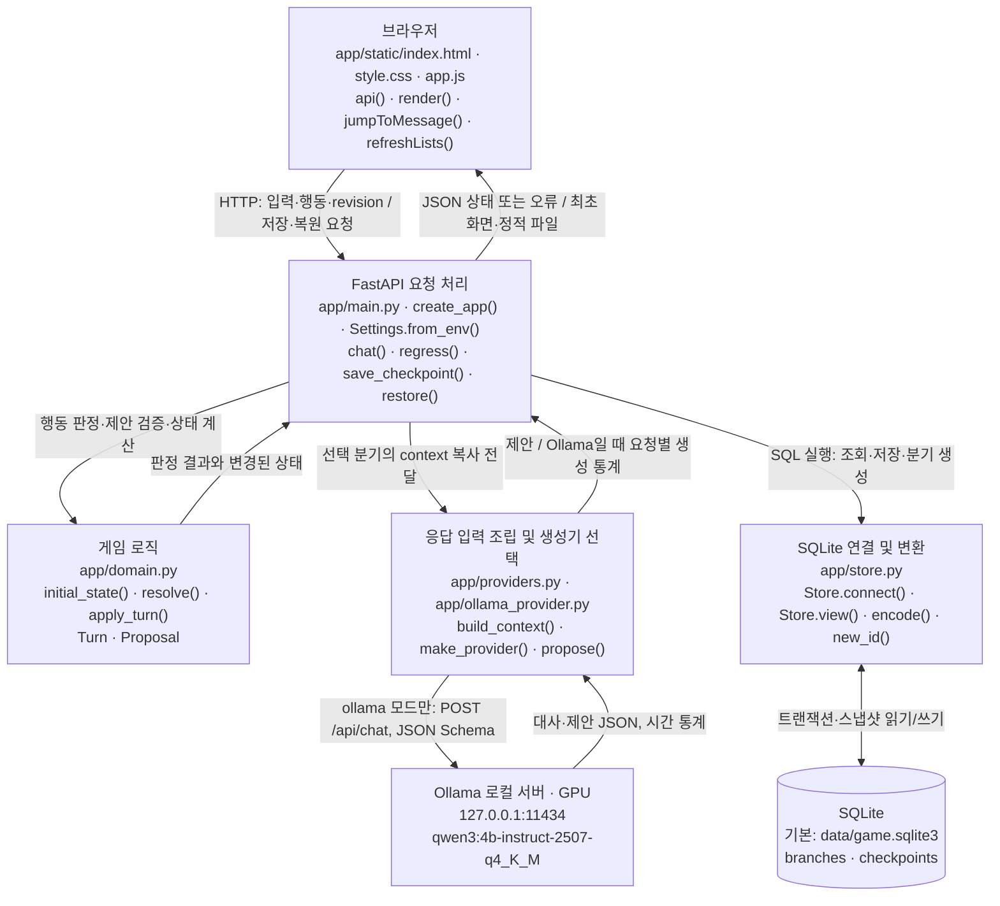
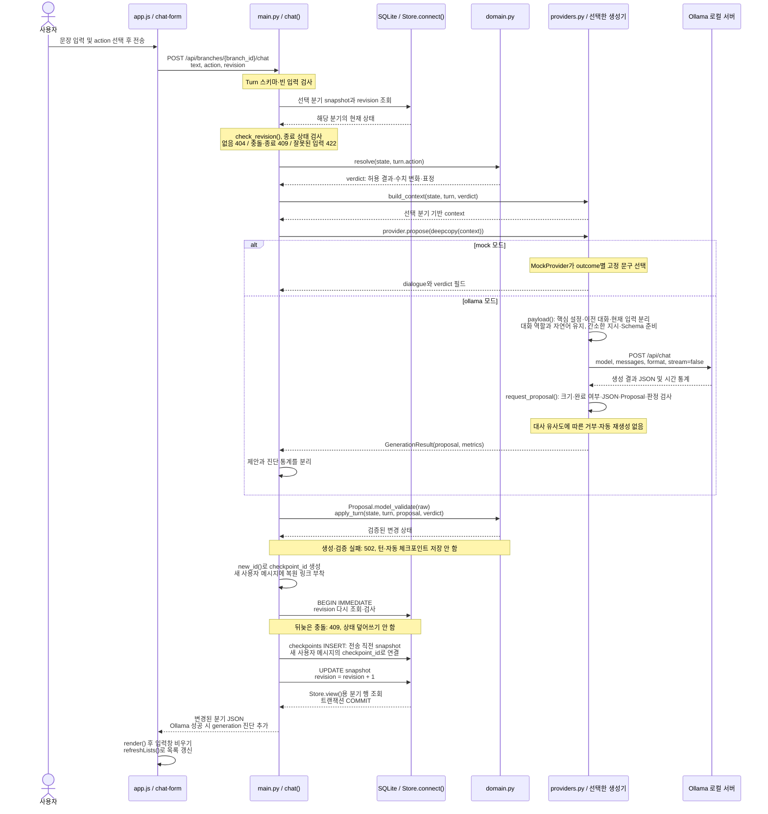
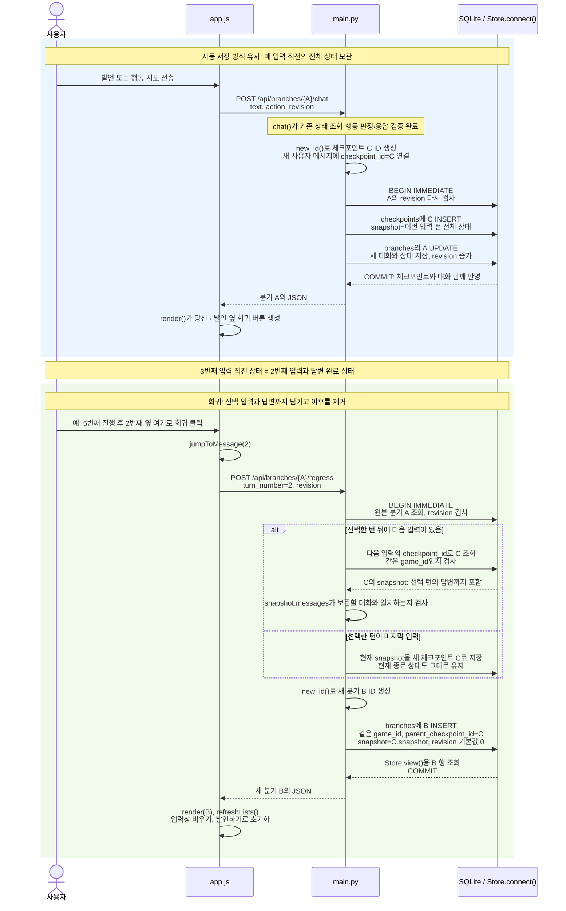

<!-- 2026-10-21 KST · 006 · dialogue-diagnosis · 변경 완료 시점 보존본, 덮어쓰지 않음 -->

# 현재 코드로 보는 캐릭터 채팅 구조

확인일: 2026-10-21. `app/`의 Python 코드, 브라우저 JavaScript, SQLite 스키마를 직접 읽고 작성했다. 이번 단계에서는 정상 답변까지 오류로 만들던 유사도 차단과 강제 재생성을 제거하고 반복 현상을 분리 진단했다. 품질 개선 근거가 없던 프롬프트 축약 실험은 채택하지 않고 기존 설정·장면 지시를 보존했다. 게임 규칙·저장·회귀 기준은 유지한다.

문서 관리 기준일: 2026-10-21 (Asia/Seoul). 현재 단계는 **006 · dialogue-diagnosis**다. 이 파일은 실제 코드에 맞춰 갱신하는 최신 문서다. 최초 구조는 [001-mock](001-mock.md), 변경 전 회귀 구조는 [003-turn-regression](003-turn-regression.md), Ollama 최초 연결 구조는 [004-ollama](004-ollama.md), 이전 반복 차단 구조는 [005-dialogue-repetition](005-dialogue-repetition.md), 현재 구조는 [006-dialogue-diagnosis](006-dialogue-diagnosis.md)에 보존한다. 작업별 변경 유형·이유·검증·남은 문제는 [변경 기록](../changes.md), 유지 규칙은 [AGENTS.md](../../AGENTS.md)를 따른다.

## 1. 현재 응답 생성기

**기본 모드는 mock이며 모델명은 없다. Ollama 모드를 선택하면 실제 로컬 LLM을 사용한다.** 실제 검증한 최종 모델은 **`qwen3:4b-instruct-2507-q4_K_M`**이다. 연결·설치·실행·측정 결과는 [Ollama 안내](../ollama.md)에 있다.

| 확인 항목 | 실제 구현과 근거 |
| --- | --- |
| 설정 읽기 | [app/settings.py](../../app/settings.py)의 `Settings.from_env()` |
| 생성기 선택 | [app/main.py](../../app/main.py)의 `create_app(db_path, provider, settings)`가 명시적 provider 또는 `make_provider(settings)` 사용 |
| 기본 모드 | `CHARACTER_CHAT_PROVIDER=mock` (생략해도 mock). `MockProvider.propose()`가 결과별 고정 문구 반환 |
| 실제 모델 모드 | `CHARACTER_CHAT_PROVIDER=ollama`. [OllamaProvider](../../app/ollama_provider.py)의 `payload()`·`propose()`가 로컬 서버의 `/api/chat` 호출 |
| 모델 선택 | `OLLAMA_MODEL`, 기본 `qwen3:4b-instruct-2507-q4_K_M`. 모델명만 바꿔도 다운로드하거나 실행하지는 않음 |
| 반환 형식 | mock은 제안 dict, Ollama는 `GenerationResult(proposal, metrics)`. 서버가 제안을 독립 검증 |
| 실행 모드 확인 | `GET /api/health`가 실제 provider 클래스명과 설정 모델명 반환. 연결·GPU 상태 검사는 아님 |

mock health의 모델은 `null`, Ollama health의 모델은 설정된 문자열이다. mock은 Ollama 서버·GPU 없이 사용할 수 있다. 잘못된 모드 설정은 시작 시 거부하고, Ollama 연결 실패를 mock으로 몰래 대체하지 않는다. 상태 판정은 두 모드 모두 동일한 서버 규칙을 사용한다.

## 2. 전체 구조 — 현재 구현

**쉬운 설명:** 브라우저는 입력을 보내고 결과를 그리는 화면이다. FastAPI는 요청을 받아 게임 규칙과 응답 생성기를 호출한다. 게임 로직이 허용되는 행동 결과를 결정한다. mock은 고정 문구를, Ollama는 로컬 모델이 만든 대사와 제안을 돌려준다. 어느 모드든 검증은 서버가 수행한다. 검증을 통과하면 전송 직전 자동 체크포인트와 변경된 상태를 같은 트랜잭션으로 SQLite에 저장한다.

게임 로직·응답 생성기는 같은 Python 앱 안의 모듈이다. 각각 별도 서버가 아니다. mock은 외부 호출·GPU 사용이 없고, Ollama는 별도 로컬 서버를 HTTP로 호출한다. 실제 모델은 그 서버에서 GPU로 실행한다. 그림의 O 경로는 Ollama 모드에서만 사용한다. SQL 문장은 주로 `main.py`에 있고, `store.py`는 연결·트랜잭션·JSON 변환을 담당한다. 기본 DB 경로는 `CHARACTER_CHAT_DB` 환경변수 또는 `create_app(db_path=...)` 인자로 바꿀 수 있다.

### 파일과 함수 연결

| 구성요소 | 실제 파일 | 주요 함수·클래스와 역할 |
| --- | --- | --- |
| 화면 구조·스타일 | [index.html](../../app/static/index.html), [style.css](../../app/static/style.css) | 입력창, 행동 선택, 관계 수치, 분기 선택. 발언별 복원 버튼은 JavaScript가 생성한다. 이 두 파일에는 주요 처리 함수가 없음 |
| 브라우저 동작 | [app.js](../../app/static/app.js) | `api()` HTTP 요청, `run()` 처리 중 잠금과 오류 표시, `render()` 상태와 발언별 복원 버튼 표시, `jumpToMessage(turnNumber)` 선택 대화 완료 시점으로 회귀, 입력창 초기화, `refreshLists()` 분기 목록 조회, `controls()` 입력 활성/비활성, 초기 health 조회로 모드·모델 표시, `generation`으로 응답 시간 표시 |
| 화면 이벤트 | 같은 `app.js` | `chat-form`의 `submit`, `new-game`·`load-branch`와 발언별 복원 버튼의 `click`에 익명 핸들러를 등록. 복원 버튼은 `jumpToMessage()`를 호출한다. 별도의 이름 있는 전송 함수는 없음 |
| API와 흐름 제어 | [main.py](../../app/main.py) | `create_app()`, `chat()` 자동 체크포인트와 턴의 원자적 저장, `new_game()`, `save_checkpoint()` 기존 수동 저장 API, `regress()` 선택 턴 이후 제거, `restore()` 지정 체크포인트 복원, `get_branch()`, `branches()`, `checkpoints()`, `health()` |
| 요청·응답 형식 | [domain.py](../../app/domain.py), [main.py](../../app/main.py) | `Turn` 입력 검증, `Proposal` 제안 검증, `CheckpointRequest` 저장 요청 검증, `RegressRequest` 대화 번호·revision 검증 |
| 캐릭터와 게임 규칙 | [domain.py](../../app/domain.py) | `CONFIG`, `initial_state()` 초기 상태, `resolve()` 행동 결과, `apply_turn()` 제안 대조·수치·사건·대화·기억·요약 갱신 |
| 응답 생성 경계 | [providers.py](../../app/providers.py) | `ResponseProvider` 호출 형태 정의, `make_provider()` 생성기 선택, `GenerationResult` 요청별 제안·측정값, `ProviderError` 공개 가능한 오류, `MockProvider.propose()` 고정 응답, `build_context()` 선택 분기의 생성기 입력 조립 및 UI용 `checkpoint_id` 제외 |
| 생성기 설정 | [settings.py](../../app/settings.py) | `Settings.from_env()`로 모드·주소·모델·대기 제한·문맥 크기 설정 읽기 |
| 실제 모델 호출 | [ollama_provider.py](../../app/ollama_provider.py) | `OllamaProvider.payload()` 대화 역할·자연어 발언·스키마·단일 요청 문맥 예산, `request_proposal()` HTTP·파싱·제안 검증, `propose()` 1회 호출·시간 측정, `unique_object()` 중복 JSON 필드 거부 |
| 검증 및 수동 실행 | [verify_ollama.py](../../scripts/verify_ollama.py), [serve_ollama.sh](../../scripts/serve_ollama.sh) | `main()` 임시 DB에서 실제 모델 검증, 스크립트로 프로젝트 내부 Ollama 수동 실행 |
| 저장 연결 | [store.py](../../app/store.py) | `Store.__init__()` 테이블 생성, `Store.connect(write=True)` 쓰기 트랜잭션, `Store.view()` API용 분기 객체, `encode()` JSON 직렬화, `new_id()` UUID 생성 |

`main.py`의 라우트 함수와 `branch()`·`check_revision()`은 `create_app()` 내부에 정의되어 있다. 표의 함수명은 코드에 있는 이름이다.

## 3. 메시지 한 번 전송 시 처리 순서

**쉬운 설명:** 사용자의 문장을 바로 사실로 저장하는 것이 아니라, 선택된 행동에 적용할 규칙을 먼저 정한다. 선택한 생성기가 그 판정에 맞는 대사와 수치를 제안한다. Ollama 오류·잘못된 JSON·잘못된 제안은 저장 전에 502로 거부한다. 직전 대사와 같거나 비슷해도 형식·상태가 유효하면 저장한다. 유사도는 게임 실패 조건이 아니다. 서버는 제안의 형식과 내용이 허용된 판정과 같은지 검사한 뒤, 대화·상태와 전송 직전 체크포인트를 같은 트랜잭션으로 저장한다. 사용자 메시지의 `checkpoint_id`는 그 입력 직전의 상태를 가리킨다. 회귀 버튼은 선택 입력 자체의 ID 대신 **다음 입력의 직전 상태**를 사용해 선택한 입력과 답변까지 남긴다. 마지막 입력이면 현재 상태를 사용한다. 생성·검증 실패나 revision 충돌에서는 턴도 자동 체크포인트도 저장하지 않고, DB 쓰기 도중 실패하면 둘 다 롤백한다.

`revision`은 “이 상태가 몇 번 갱신됐는가”를 나타내는 충돌 검사 번호다. 처음 읽을 때와 저장 직전에 두 번 검사한다. 같은 이전 상태에서 두 요청이 동시에 출발해도 먼저 저장한 결과를 뒤의 요청이 덮어쓰지 못하게 한다. 응답 생성 중에는 쓰기 트랜잭션을 열어 두지 않는다.

그림은 정상 경로를 이어 그렸으며 오류 시에는 해당 지점에서 반환한다. 브라우저는 반환된 오류 메시지를 `run()`에서 표시한다.

### 현재 행동 판정

| `action` | `resolve()`의 결과 | 신뢰 변화 | 경계 변화 | 종료 |
| --- | --- | --- | --- | --- |
| `speak` | `conversation` | 0 | 0 | 아니오 |
| `request_access` | `access_refused` | 0 | +5 | 아니오 |
| `force_access`, 이전 시도 0회 | `warning` | -15 | +25 | 아니오 |
| `force_access`, 이전 시도 1회 이상 | `expelled` | -15 | +25 | 예 |
| `leave` | `left` | 0 | 0 | 예 |

수치는 `apply_turn()`에서 0–100으로 제한한다. 강제 접근 시도 횟수는 서버가 증가시킨다. 이 버전에는 열람 성공이나 신뢰 상승 경로가 없다. 문장에 “강제로 연다”라고 써도 `action=speak`이면 발언으로 처리한다. 자연어 행동 추론은 구현되지 않았다.

`Proposal`은 필드·타입·범위를 검사하고, `apply_turn()`은 표정·수치 변화·결과를 서버 판정과 대조한다. 대사가 세계관과 의미상 모순되는지를 판독하는 검사는 현재 없다. 핵심 설정이 상태에서 바뀌지 않는 것과 향후 LLM 대사의 의미적 일관성은 별도 문제다.

## 4. 발언별 자동 체크포인트와 대화 완료 시점 회귀

**쉬운 설명:** 5번째까지 진행한 뒤 2번째 발언의 **↶ 여기로 회귀**를 누르면 **1·2번째 입력과 답변만 남는다. 3·4·5번째 입력·답변과 그때 생긴 관계 변화·사건·기억은 복원된 분기에 없다.** 입력창은 비워지고 새로운 3번째 대화를 시작한다. 이전 기록은 원본 분기에만 보존된다.

전체 상태를 정확히 복원하기 위해 “2번째 입력 이전”이 아니라 **3번째 입력 이전에 저장한 상태**를 가져온다. 이것이 2번째 답변까지 끝난 상태다. 대화만 잘라 내고 관계·기억을 그대로 두거나, 모델을 다시 호출해서 과거를 재생하지 않는다. 선택한 입력과 답변도 재생성하지 않는다.

`RegressRequest`는 1부터 시작하는 `turn_number`와 최신 `revision`을 받는다. `regress()`는 같은 게임의 체크포인트인지와 대화 앞부분이 일치하는지를 확인한다. 마지막 턴은 현재 상태 자체가 정확한 완료 상태이므로 새 체크포인트로 보존한다. 종료가 발생한 턴 자체로 회귀하면 종료도 유지되고, 그보다 앞선 턴으로 돌아가면 그때 상태가 복원된다.

회귀는 같은 게임의 새 분기를 만들며 원본을 수정하지 않는다. `Store.connect(write=True)` 안에서 revision 검사·스냅샷 선택·분기 생성을 처리한다. 오래된 revision이나 과거 상태 누락·불일치는 409, 대화 번호·타입 오류는 422, 원본 분기 누락은 404다. 실패하면 새 분기를 만들지 않는다.

DB 테이블·컬럼과 매 입력 전 자동 저장 방식은 002와 같다. 이전 버전이 만든 `checkpoint_id`를 다음 입력에서 찾으므로 002 데이터도 그대로 사용할 수 있다. 정확한 완료 상태가 저장되지 않은 오래된 지점은 버튼을 비활성화하고 서버도 회귀를 거부한다. 현재 마지막 지점은 현재 상태가 있으므로 회귀할 수 있다.

기존 수동 저장·목록 API와 `restore(checkpoint_id)` API도 보존했다. 이 API는 지정된 스냅샷을 그대로 복원하므로 여전히 입력 직전 체크포인트를 직접 지정할 수도 있다. 화면의 **회귀 버튼은 새 `regress()` API만 호출**한다. 별도 체크포인트 패널은 없다.

### 실제로 함께 저장하는 내용

| 스냅샷 필드 | 의미 |
| --- | --- |
| `messages` | 저장 시점까지의 사용자 발언·행동 선택과 캐릭터 대사. 새 사용자 메시지는 전송 직전 상태의 `checkpoint_id`도 포함 |
| `summary`, `memories` | 확정 상태로 만든 요약, 서버가 기록한 사건 기억 |
| `trust`, `guard`, `expression` | 관계 수치와 표정 |
| `events`, `ended` | 강제 접근 횟수·기록 봉인·종료 사유 및 종료 여부 |
| `config_version`, `config` | 설정 버전과 해당 핵심 설정 본문 |

이 내용은 각각 별도 테이블이 아니라 JSON 문자열 하나인 `snapshot`에 함께 저장된다. `branches`에는 각 분기의 현재 snapshot, `checkpoints`에는 저장 당시 snapshot이 있다. 현재 API에는 체크포인트를 수정하는 경로가 없다.

회귀 분기의 revision은 충돌 검사용으로 0부터 시작한다. 화면의 “대화 N회”는 실제 사용자 메시지 수로 계산하므로 2번째로 회귀하면 2회로 표시된다. 보존된 분기 목록에서는 혼동을 주던 revision 기반 턴 수를 제거했다.

### 미래 정보가 입력에 섞이지 않는 경로

복원 뒤 `chat()`은 새 분기 B의 snapshot만 읽는다. `build_context()`는 그 상태의 설정, 신뢰·경계·사건·요약·기억, 대화 전체와 이번 입력·판정을 묶는다. 다른 분기, 원본 A의 최신 대화, 체크포인트 목록은 읽지 않는다.

`refreshLists()`는 UI 표시를 위해 분기 메타데이터만 조회한다. 목록은 provider 입력에 넣지 않고, `build_context()`는 각 대화의 UI용 `checkpoint_id`도 제거한다. 현재 mock이 입력 내용을 실제 추론에 사용하는 것은 아니지만, 입력을 분리하는 코드는 이미 존재한다.

저장된 대사는 그대로 복원한다. 향후 실제 LLM이 복원 이후 새로 만들 문장까지 동일하게 재현하는 기능은 현재 구현되어 있지 않다.

자동 체크포인트는 전체 상태를 매 턴 복사하므로 긴 대화에서는 저장량이 빠르게 늘어난다. 보존·정리 정책은 아직 없다.

기존 회귀·상태 검증은 [test_game.py](../../tests/test_game.py), Ollama HTTP·모드 선택·오류·격리는 [test_ollama.py](../../tests/test_ollama.py)에 있다. **Python 테스트 58개 통과**. 실제 `app.js`의 회귀 동작은 [test_ui.cjs](../../tests/test_ui.cjs)로 DOM 대역에서 실행해 통과했다. Node 구문·셸 문법 검사도 통과했다.

실제 모델 검증은 `안녕` 2회와 장소 질문 2회·업무 질문·설정 무시·열람 거절·경고·종료·회귀 뒤 입력의 10사례다. 반복 여부는 보고서의 `repeats_previous`에 관찰값으로만 남기며 성공 조건으로 삼지 않는다. 회귀 뒤 미래 컨텍스트 격리도 검사한다. 비교 실험과 실제 검증 결과·한계는 [006 진단 기록](../dialogue-diagnosis.md)에 있다. 사용자 서버를 종료하거나 플레이 DB를 변경하지 않았다. 실제 사용자 브라우저·VS Code 렌더링은 직접 확인하지 못했고, Starlette/httpx 사용 중단 예정 경고 1개가 남아 있다.

## 5. Ollama 구현과 향후 계획 구분

| 항목 | 현재 구현 | 향후 계획·한계 |
| --- | --- | --- |
| 생성기 선택 | mock 기본, 환경변수로 Ollama 선택, 명시적 provider 주입도 유지 | 유료 외부 LLM API adapter는 미구현 |
| 구조화 출력 | Proposal 스키마·서버 verdict const 및 독립 검증 | 대사 의미 전체를 판독하는 자동 모순 검사는 미구현 |
| 오류 처리 | 연결·타임아웃·HTTP·JSON·미완성·잘못된 제안·문맥 예산 초과 시 턴 저장 안 함 | 유사도 차단·자동 재시도·스트리밍·mock 대체 없음 |
| 문맥 | 선택 분기 전체 정보·대화 역할 유지, 사용자 자연어 발언 전달, 복원 링크 제외, 단일 요청의 보수적 예산 검사 | 정확한 토큰 계산·긴 대화 요약 최적화 미구현 |
| 측정 | 성공 응답의 요청별 모델명·elapsed_ms·Ollama 통계, 실제 검증 스크립트의 /api/ps 확인 | 화면 health만으로 GPU 사용을 판정하지 않음 |
| 체크포인트 | 게임 설정·대화·요약·기억·관계·사건 버전 복원 | 모델 선택은 현재 서버 설정을 따르며 과거 생성 환경까지 고정하지 않음 |

기본 temperature는 0.6이다. `generation.attempts`는 1이며 `elapsed_ms`와 Ollama 통계는 한 번의 호출을 나타낸다. 같은 발언 감지용 추가 지시·유사도 비교·강제 재생성은 없다. 기존 설정·장면 지시와 선택 분기의 대화 역할·발언 전달은 유지한다. 문자열 반복은 상태 변경 오류가 아니므로 저장을 막지 않는다. 실제 모델은 여전히 이전 대사를 복사할 수 있으며, 반복 생성의 단일 원인은 확인하지 못했다. 프롬프트 축약·형식 변경만으로 해결됐다는 근거도 없어 실험 변경을 채택하지 않았다.

실제 선택 모델, 크기, GPU 메모리, 응답 시간, 한국어 대사 품질의 남은 문제는 [Ollama 검증 보고](../ollama.md)에 있다. 모델 학습·파인튜닝은 하지 않았다. 설치는 프로젝트 `.runtime/` 및 최초 Ollama 키용 `~/.ollama`의 사용자 파일 범위이며 시스템 Python·드라이버·서비스 설정은 변경하지 않았다.

## 6. VS Code에서 그림으로 보기

1. VS Code에서 이 프로젝트를 열고 `docs/architecture.md`를 선택한다.
2. **Ctrl+Shift+V**로 Markdown 미리보기를 연다. 코드와 그림을 나란히 보려면 **Ctrl+K를 누른 뒤 V**를 누른다.
3. 또는 **Ctrl+Shift+P**에서 `Markdown: Open Preview to the Side`를 실행한다.

VS Code 공식 문서에 따르면 기본 Markdown 미리보기는 `mermaid` 코드 블록을 그림으로 렌더링한다. [공식 Markdown 안내](https://code.visualstudio.com/docs/languages/markdown#markdown-preview)

이번에 접근한 환경의 VS Code 서버 `package.json` 버전은 **1.142.0**이고, `extensions/mermaid-markdown-features` 폴더가 존재한다. 따라서 먼저 **추가 설치 없이 기본 미리보기**를 사용한다. 내장 `Mermaid Markdown Features`는 VS Code 1.121에 통합되었다. [공식 1.121 변경 사항](https://code.visualstudio.com/updates/v1_121/)

이 확인은 도구 환경의 서버 파일 기준이며, 사용자가 보는 VS Code 클라이언트의 정확한 버전·내장 확장 활성 상태·최종 그림 렌더링을 직접 확인한 것은 아니다.

그림 대신 코드가 보이면 다음을 확인한다.

- 일반 텍스트 편집기 대신 **Markdown 미리보기**를 열었는지 확인한다.
- 확장 화면에서 `@builtin mermaid`를 검색해 `Mermaid Markdown Features`가 비활성인지 확인한다.
- 사용자 클라이언트가 내장 지원 이전 버전이라면 추가 확장 또는 업데이트가 필요할 수 있다. 그 경우에는 먼저 현재 버전과 필요한 변경을 설명한 뒤 설치 여부를 결정한다.

**이번 작업에서는 확장 설치·활성화 변경·VS Code 업데이트를 수행하지 않았다.** 미리보기 안내는 공식 문서와 설치 파일 확인 기준이며, 실제 화면의 렌더링 검증은 하지 못했다.
