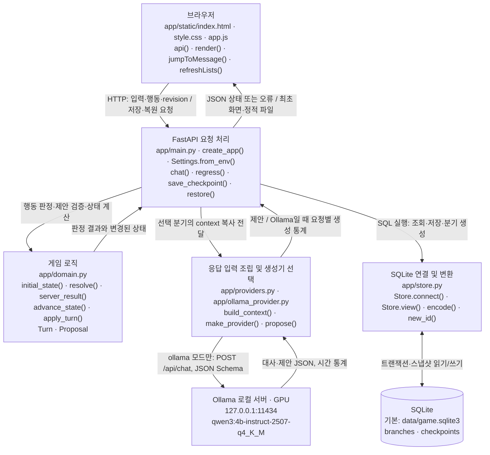
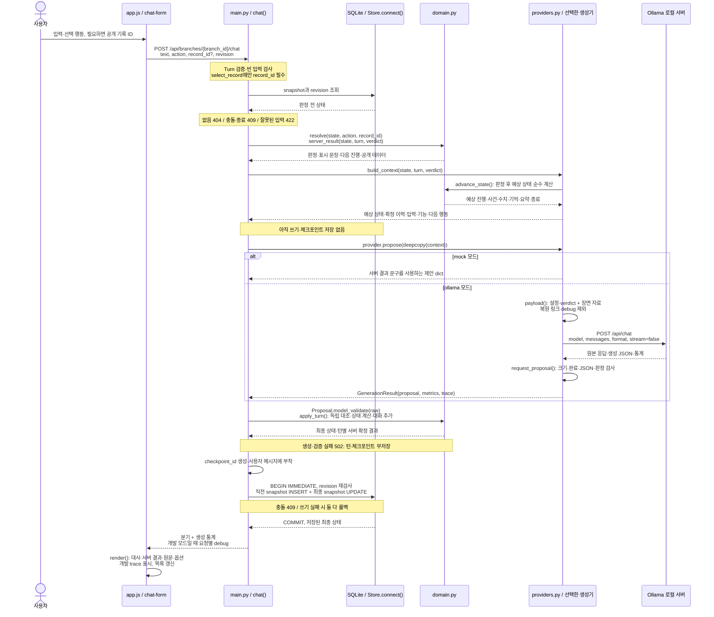
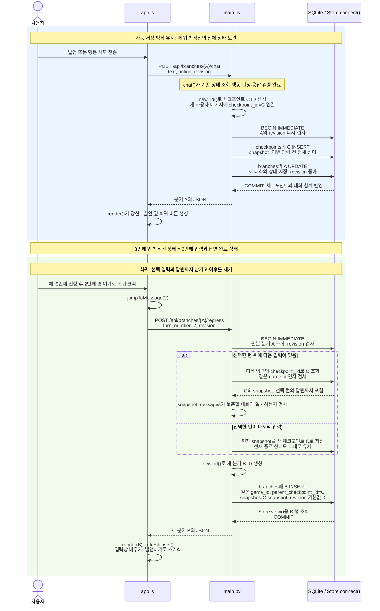

<!-- 2026-10-21 KST · 007 · public-records · 보존본, 덮어쓰지 않음 -->

# 현재 코드로 보는 캐릭터 채팅 구조

확인일: 2026-10-21 (Asia/Seoul). 현재 단계는 **007 · public-records**다. 이 문서는 최신 코드 설명이며 [007 스냅샷](007-public-records.md)은 이번 보존본이다. 변경 전 구조는 [006](006-dialogue-diagnosis.md), 최초 mock은 [001](001-mock.md), 변경 이유·검증은 [changes.md](../changes.md)에 있다.

## 1. 현재 동작과 범위

기본 생성기는 **MockProvider**, 모델명은 없다. `CHARACTER_CHAT_PROVIDER=ollama`이면 실제 **OllamaProvider**를 사용한다. 이번 검증 모델은 `qwen3:4b-instruct-2507-q4_K_M`다. `/api/health`는 설정된 모드·모델을 보여 주며 접속·GPU 추론 성공을 보장하지 않는다.

archive-2.0 새 게임은 공개 기록 3개의 고정 이름·본문과 목록 요청 → 기록 선택 → 열람의 성공 경로를 제공한다. 봉인 요청은 거절, 강제 접근은 경고 후 재시도 종료다. **신분증 검증·허가 발급·자유문장 행동 해석은 미구현이다.** 발언하기로 행동을 묘사해도 실행되지 않는다.

중요한 성공·실패·종료·다음 진행과 원문은 별도 **서버 확정 결과**로 표시한다. 모델의 자유 대사 전체를 의미 분석해 참·거짓 판정하는 기능은 없다. 자동 상태 검증과 [실제 대사 품질 검토](../reports/007-ollama-quality.md)는 구분한다.

## 2. 전체 구조 — 현재 구현

**쉬운 설명:** 브라우저는 선택 행동과 입력을 보낸다. FastAPI는 게임 규칙으로 결과를 정하고, 그 결과를 적용했을 때의 상태를 생성기에 전달한다. 모델 대사만으로 사건을 완료하지 않는다. 생성·검증이 끝나면 상태와 체크포인트를 함께 저장한다. 화면은 모델 대사와 서버 결과를 구분하며, 원문은 서버 고정 데이터를 보여 준다. mock과 Ollama의 판정·저장 규칙은 같다.

게임 로직·응답 생성기·저장 연결은 같은 Python 앱의 모듈이다. Ollama만 별도 로컬 서버이며 mock에서는 O 경로를 사용하지 않는다. SQL은 주로 main.py에 있고 store.py는 연결·트랜잭션·변환을 제공한다.

### 실제 파일과 주요 함수

| 구성요소 | 파일·주요 이름 | 역할 |
| --- | --- | --- |
| 화면·스타일 | [index.html](../../app/static/index.html), [style.css](../../app/static/style.css) | 선택 행동, 기록 선택 상자, 서버 결과 카드, 개발 details 패널 |
| 브라우저 | [app.js](../../app/static/app.js): `api()`, `run()`, `render()`, `controls()`, `node()`, `syncRecordControl()`, `showDebug()`, `jumpToMessage()`, `refreshLists()` | 전송·오류·기록 옵션·결과·개발 trace 표시·회귀·분기. 행동은 빈 문장 대신 행동 라벨 전송 |
| API | [main.py](../../app/main.py): `create_app()`, 내부 `chat()`, `new_game()`, `get_branch()`, `branches()`, `health()`, `regress()`, `save_checkpoint()`, `checkpoints()`, `restore()`, `branch()`, `check_revision()` | 요청 검증·결과 계산·생성 호출·CAS·원자적 저장·분기. chat 내부 `generation_error()`는 개발 오류 진단 추가 |
| 데이터·규칙 | [domain.py](../../app/domain.py): `PUBLIC_RECORDS`, `CONFIG`, `Turn.selection_matches_action()`, `Proposal`, `initial_state()`, `resolve()`, `server_result()`, `advance_state()`, `apply_turn()` | 고정 데이터, 입력·제안 형식, 판정, 결과 문장·다음 진행, 순수 예상 상태 계산, 독립 대조 후 대화 추가 |
| 생성 경계 | [providers.py](../../app/providers.py): `make_provider()`, `MockProvider.propose()`, `build_context()`, `GenerationResult`, `ProviderError`, `ResponseProvider` | 생성기 선택, 예상 상태·확정 이력·지원 기능·가능한 다음 행동 조립. DB 접근 없음 |
| 모델 호출 | [ollama_provider.py](../../app/ollama_provider.py): `OllamaProvider.payload()`, `request_proposal()`, `propose()`, `unique_object()` | 스키마·장면 자료·예산 검사·1회 HTTP 호출·원본 및 제안 검증·요청별 통계·trace. 유사도 차단·재시도 없음 |
| 설정 | [settings.py](../../app/settings.py): `Settings.from_env()` | 모드·모델·URL·문맥·제한·CHARACTER_CHAT_DEV. .env 자동 로딩 없음 |
| SQLite | [store.py](../../app/store.py): `Store.__init__()`, `Store.connect()`, `Store.view()`, `encode()`, `new_id()` | branches/checkpoints, 트랜잭션·API 변환·JSON·UUID. 기본 data/game.sqlite3 |
| 검증 | [test_game.py](../../tests/test_game.py), [test_ollama.py](../../tests/test_ollama.py), [test_public_records.py](../../tests/test_public_records.py), [test_ui.cjs](../../tests/test_ui.cjs), [test_public_ui.cjs](../../tests/test_public_ui.cjs), [verify_ollama.py](../../scripts/verify_ollama.py): `main()` | 자동 상태·원자성·격리·DOM 대역 검증, 실제 모델 임시 DB 연속 시험 |

## 3. 메시지 한 번 전송 시 처리 순서

**쉬운 설명:** 먼저 행동 결과를 정하고, 그 결과가 반영된 예상 상태를 모델에 전달한다. 예상 상태를 계산했다고 저장한 것은 아니다. 생성·형식·수치 검증에 실패하면 이전 상태를 유지한다. 성공할 때만 대화·상태와 직전 체크포인트를 함께 저장한다. 저장 직전 revision을 다시 확인해 동시 요청이 기존 결과를 덮어쓰지 못하게 한다.

### 상태와 행동

| 상태 | 변경 기준 |
| --- | --- |
| config_version·config | 새 게임은 archive-2.0. 핵심 설정과 public_records 고정 이름·본문 포함 |
| progress.catalog_seen | list_records 성공 시 true |
| progress.selected_record | 목록 확인 뒤 유효 ID를 select_record로 선택 |
| progress.read_records | read_record 성공 시 선택 ID 추가. 중복 ID 누적 없음 |
| events.access | 봉인 기록은 계속 sealed. 공개 진행과 별개 |
| events.forced_attempts·ending·ended | 첫 강제 접근 경고, 두 번째 또는 leave 종료 |
| trust·guard·expression | 기존 서버 규칙. 공개 진행은 수치 불변 |
| messages | 입력·선택 ID, 모델 원본 대사, 턴별 server_result |
| summary·memories | 확정 상태·사건만 반영. 선택·열람 사건에는 record_id |

목록 전에 선택·열람하면 list_required, 선택 없이 열람하면 selection_required, 잘못된 ID면 record_not_found다. 잘못된 ID로 기존 선택을 지우지 않는다. select_record만 record_id가 필요하고 다른 행동에 ID를 끼우면 422다. 봉인 요청 거절은 경계 +5, 강제 접근은 신뢰 -15·경계 +25로 기존 규칙을 유지한다.

### 모델 입력과 원본 대사의 차이

`build_context()`의 state는 이번 결과를 적용한 예상 상태다. 판정 전 실제 상태는 개발 trace의 before에서 확인한다. 생성 오류·충돌 시 예상 값은 저장되지 않는다.

모델용 history는 server_result가 있는 NPC 대사를 해당 서버 결과 문장으로 바꾸고 결과 객체를 붙인다. 사용자 발언·행동은 그대로 남기며 사실로 승격하지 않는다. 서버 결과 없는 초기 인사·구버전 대사는 원문을 유지한다. 따라서 새 턴 모델 자유 대사의 표현 자체를 모델에게 기억시키는 구조는 아니다. 표시용 원본 대사는 그대로 저장·복원한다. 구버전 대사 의미를 자동 정정하지 않는다.

공개 기록은 설정에서 이름·ID만 모델에게 전달한다. 본문은 현재 열람 결과나 이 분기에 남은 과거 열람 결과로만 넣는다. JSON 장면 자료에 history·state·attempt와 이번 server_result를 명시한다. 문맥 예산 초과는 저장 전 오류이며 이력을 몰래 자르지 않는다. 정확한 토큰 계산·긴 대화 최적화는 미구현이다.

### 개발 진단

CHARACTER_CHAT_DEV=true일 때만 응답 debug와 화면 details를 제공한다. 기본 false다.

| 표시 항목 | 실제 키 |
| --- | --- |
| 선택 행동 | debug.selected_action |
| 판정 전 상태 | debug.before |
| 서버 결과 | debug.server_result |
| 생성기 입력 | debug.provider_input |
| HTTP 모델 입력 | debug.model.request_payload (Ollama) |
| 원본 출력 | debug.model.raw_output (Ollama envelope 또는 파싱 전 문자열, mock은 제안 dict) |
| 저장된 최종 상태 | debug.saved_final_state, debug.committed |

요청별 지역 데이터이며 공유 “마지막 응답”은 없다. DB·체크포인트·모델 이력에 저장하지 않는다. 재조회·회귀·다음 요청 때 이전 진단을 지운다. 생성 오류는 committed=false, 최종 상태 null과 확보한 원본 출력을 반환한다. 무응답·크기 상한에서는 원본이 null일 수 있다. 입력 검증·조회·revision·종료 등 생성 전 오류에는 진단이 붙지 않는다. 전체 대화가 표시되므로 기존 로컬 바인딩에서 직접 확인한다.

## 4. 체크포인트 저장과 복원 시 새 분기

**쉬운 설명:** 3번째 입력이 열람일 때 2번째 입력 옆으로 회귀하면 목록·선택까지만 남는다. 열람 본문·이력·이후 사건·요약·기억은 새 분기에서 사라진다. 다음 입력 직전 체크포인트가 선택한 대화 완료 상태와 같기 때문에 전체 상태를 그대로 복원한다. 원본 분기는 보존한다.

수동 save_checkpoint()/restore() API도 남아 있다. 화면은 regress()로 선택한 입력과 답변까지 남기며 마지막 대화면 현재 상태 자체를 보존한다. 복원은 모델 호출·과거 문장 재생성을 하지 않는다. 다른 분기·원본의 최신 상태·개발 trace는 모델 입력으로 가져오지 않는다.

테이블·컬럼은 동일하고 JSON snapshot 필드가 늘었다. archive-1.0 분기는 자동 변환하지 않으며 기존 읽기·봉인 행동·회귀를 유지한다. 새 공개 행동은 409로 새 게임을 안내한다. 새 기록 데이터·절차를 옛 체크포인트에 끼워 넣지 않는다. 전체 상태 복사 방식의 저장량 정리 정책은 미구현이다.

## 5. 검증·현재 한계·향후 계획

- Python 75개와 Node DOM 대역 2종 통과. 실제 브라우저 조작·레이아웃·VS Code 렌더링은 직접 확인하지 않았다.
- 실제 모델 11사례 상태·저장·회귀 격리 통과. **대사 품질은 부분 통과**이며 질문 회피·반복·원문 시간 변형·미정 설정 추가가 남았다. [원문·품질 보고](../reports/007-ollama-quality.md).
- 원본 신분증·허가 실패는 [사례 설명](../failure-cases/identity-permit-loop.md)과 [fixture](../../tests/fixtures/identity-permit-loop.json)에 보존했다. 거짓 대사가 스키마를 통과할 수 있다는 부정 테스트도 유지한다. 대사 의미 전체를 자동 검증하는 기능은 없다.
- 선택식 경로의 사용자 직접 플레이 후 자유문장 해석이 다음 단계다. 외부 유료 API·학습·추가 모델·이미지·벡터 DB는 이번에 추가하지 않았다.

## 6. VS Code에서 그림 보기

이 파일을 열고 Ctrl+Shift+V 또는 Ctrl+K 다음 V로 Markdown 미리보기를 연다. 기존 환경에서는 내장 Mermaid 기능이 확인되어 먼저 추가 설치 없이 확인한다. 이번에는 확장 설치·활성화·업데이트를 하지 않았다. 렌더링되지 않으면 VS Code 버전·활성 상태를 확인하고 설치가 필요할 때 사전에 설명한다.
