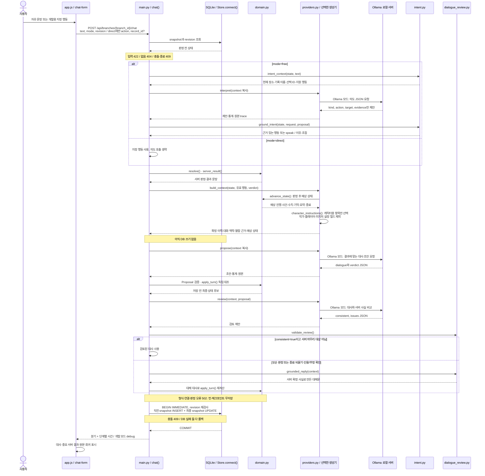
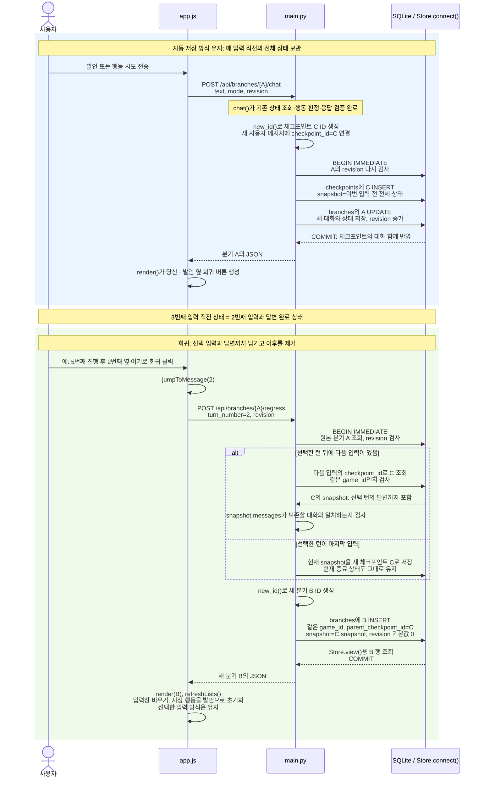

# 현재 코드로 보는 캐릭터 채팅 구조

보존일: 2026-10-21 (Asia/Seoul). **010 · scene-knowledge 보존 스냅샷. 이후 수정하지 않는다.** 현재 단계는 **010 · scene-knowledge**다. [010 스냅샷](../architecture-history/010-scene-knowledge.md)이 보존본이다. 변경 전 [009](../architecture-history/009-free-input.md), 최초 mock [001](../architecture-history/001-mock.md), [변경 기록](../changes.md), [이번 실제 장면·대사 비교](../reports/010-scene.md)를 함께 확인한다. 009 이후 잡담 프롬프트 소폭 수정과 사용자 첫 인사 수정은 주요 구조가 같았으며 이번 변경 기록에 구분한다.

## 1. 현재 동작과 범위

기본 생성기는 **MockProvider**, 모델명은 없다. `CHARACTER_CHAT_PROVIDER=ollama`이면 실제 **OllamaProvider**, 이번 검증 모델은 `qwen3:4b-instruct-2507-q4_K_M`다. `/api/health`는 설정 정보이며 GPU 추론 성공의 증거는 아니다. 설치·모델·시스템 Python은 이번에 변경하지 않았다.

브라우저 기본은 **자유 대화·행동 시도**다. 모델은 의도·대상·입력 근거만 제안하고 서버가 지원 행동에 연결한다. 목록 요청, 공개 기록 선택·열람, 봉인 요청·강제 접근, 퇴장을 지원한다. 일반 대화·가정·인용·부정·모호한 요청·미지원 요청은 사건 상태를 바꾸지 않는다. 선택식 입력은 **개발용 행동 지정**으로 남겼다. API `mode` 생략은 기존 클라이언트 호환을 위해 direct다. UI 기본값과 구분한다.

새 게임의 archive-3.0은 장소·환경·캐릭터 지식·대화 지침을 분리하고 공개 기록 3개를 방문 기록·반출입 장부·보관 분류 안내로 바꿨다. 기존 archive-2.0의 빗물·등불·정원 기록은 임시 검증 데이터였으며 기존 분기 안에 보존한다. 판정·저장·회귀 규칙은 유지한다. 신분증 검증·허가 발급은 미지원이다. 핵심 설정은 대화로 수정할 수 없다. 한 입력에 행동 하나만 연결하는 최소 구현이며, 모든 자연어 표현을 정확하게 해석한다고 보장하지 않는다.

중요 결과·원문은 서버 카드에 표시한다. **대사도 별도로 검토**한다. 검토가 모순을 판정하면 초안을 버리고 서버 사실로 만든 짧은 대사를 저장한다. 종료·되묻기·봉인 관련 인용/부정 확인은 검토 누락 사례 때문에 서버가 최종 문장을 확정한다. 검토 형식 오류·연결 실패는 턴 전체를 저장하지 않는다. 이 검토는 같은 LLM의 확률적 판단이며 오탐·누락 가능성이 있다. 상태 검증, 검토 모델 판정, 사람이 읽은 대사 품질을 같은 결과로 취급하지 않는다.

## 2. 전체 구조 — 현재 구현

```mermaid
flowchart TB
    B["브라우저<br/>app/static/index.html · style.css · app.js<br/>api() · render() · jumpToMessage() · refreshLists()"]
    F["FastAPI 요청 처리<br/>app/main.py · create_app() · Settings.from_env()<br/>chat() · regress() · save_checkpoint() · restore()"]
    G["게임 로직<br/>app/domain.py<br/>initial_state() · resolve() · server_result()<br/>advance_state() · apply_turn()<br/>Turn · Proposal"]
    P["응답 입력 조립 및 생성기 선택<br/>app/providers.py · app/ollama_provider.py<br/>build_context() · character_instructions()<br/>make_provider() · interpret() · propose() · review()"]
    S["SQLite 연결 및 변환<br/>app/store.py<br/>Store.connect() · Store.view() · encode() · new_id()"]
    D[("SQLite<br/>기본: data/game.sqlite3<br/>branches · checkpoints")]
    O["Ollama 로컬 서버 · GPU<br/>127.0.0.1:11434<br/>qwen3:4b-instruct-2507-q4_K_M"]
    I["의도 제안 검증·행동 연결<br/>app/intent.py<br/>intent_context() · ground_intent()<br/>non_attempt_reason() · IntentProposal"]
    R["대사 검토 형식·확정 대체문<br/>app/dialogue_review.py<br/>validate_review() · grounded_reply()"]

    B -->|"HTTP: 자유 문장 또는 지정 행동 / 저장·복원"| F
    F -->|"JSON 상태 또는 오류 / 화면·정적 파일"| B
    F -->|"행동 판정·제안 검증·상태 계산"| G
    G -->|"판정 결과와 예상 상태"| F
    F -->|"선택 분기 자료로 의도·대사·검토 호출"| P
    P -->|"제안·검토 / 요청별 통계"| F
    F -->|"SQL 실행: 조회·저장·분기 생성"| S
    S <-->|"트랜잭션·스냅샷 읽기/쓰기"| D
    P -->|"ollama 모드: POST /api/chat, JSON Schema"| O
    O -->|"의도・대사・검토 JSON, 시간 통계"| P
    F <-->|"free일 때 근거·대상 검증, 상태 변경 없음"| I
    F <-->|"검토 형식 검증・거절 초안 대체"| R
```

**쉬운 설명:** 새로 추가한 의도 단계는 문장을 기존 행동 이름으로 바꾸는 연결부다. 성공 여부는 기존 게임 로직이 결정한다. 모델이 결과에 맞춰 대사를 작성한 뒤 별도 검토를 받으며, 문제가 있다고 판정된 초안은 대화에 들어가지 않는다. 모든 단계가 끝난 뒤에만 DB에 저장한다. 게임 로직·의도·생성기·검토·저장은 한 Python 앱의 모듈이고 Ollama만 별도 서버다. 기존 노드 이름·방향을 유지하고 I/R을 추가했다. Mermaid 자동 배치의 위치는 달라질 수 있다.

### 실제 파일과 주요 함수

| 구성요소 | 파일·주요 이름 | 역할 |
| --- | --- | --- |
| 화면 | [index.html](../../app/static/index.html), [style.css](../../app/static/style.css), [app.js](../../app/static/app.js): `syncInputMode()`, `syncRecordControl()`, `render()`, `api()`, `showDebug()`, `jumpToMessage()`, `refreshLists()` | 자유 입력 기본, 개발 행동 지정, 중요 서버 카드·원문·개발 trace·회귀. 일반 발언 접수 카드는 숨김 |
| API | [main.py](../../app/main.py): `create_app()` 내부 `chat()`, `check_revision()`, `generation_error()`, `regress()`, `save_checkpoint()`, `restore()` | 단계 순서, 복사, 오류·CAS·원자적 저장, 새 분기 |
| 의도 | [intent.py](../../app/intent.py): `IntentProposal`, `Decision`, `intent_context()`, `ground_intent()`, `non_attempt_reason()`, `mock_interpret()` | 엄격 제안 스키마, 입력 근거·대상 확인, 가정·인용·부정 등 보수적 실행 거부, 지원 행동 연결. DB 접근·상태 변경 없음 |
| 규칙 | [domain.py](../../app/domain.py): `PUBLIC_RECORDS`, `CONFIG`, `Turn`, `Proposal`, `resolve()`, `server_result()`, `advance_state()`, `apply_turn()` | 기존 고정 기록·판정·수치·종료·독립 제안 대조. 새 게임 archive-3.0과 캐릭터용 환경·지식·지침, Turn의 free/direct 유지 |
| 생성 경계 | [providers.py](../../app/providers.py): `ResponseProvider`, `MockProvider.interpret/propose/review()`, `make_provider()`, `build_context()`, `confirmed_history()`, `conversational_history()`, `reading_context()`, `character_instructions()` | 생성기 분리, 현재 분기 전용 자료·확정 사건·회상·검토된 대화 맥락, 캐릭터용 설정 항목만 선택 |
| 모델 호출 | [ollama_provider.py](../../app/ollama_provider.py): `interpret()`, `payload()`, `propose()`, `review()`, `structured_stage()`, `stage_payload()`, `request_object()`, `request_proposal()` | 동일 모델로 의도→대사→검토. 요청별 스키마·크기·완료·JSON·문맥 예산 검사, 통계·원본 trace. 재시도·유사도 차단 없음 |
| 대사 검토 | [dialogue_review.py](../../app/dialogue_review.py): `DialogueReview`, `Violation`, `validate_review()`, `required_reply_reason()`, `grounded_reply()` | 검토 JSON 일관성 검사·서버 근거 대체문. 의미 판단은 provider.review이며 이 파일이 완전한 의미 판독기는 아님 |
| 저장·설정 | [store.py](../../app/store.py): `Store.connect()`, `Store.view()`, `encode()`, `new_id()` / [settings.py](../../app/settings.py): `Settings.from_env()` | 기존 SQLite 트랜잭션·스키마·설정. .env 자동 로딩 없음 |
| 검증 | [test_free_input.py](../../tests/test_free_input.py), [test_free_ui.cjs](../../tests/test_free_ui.cjs), [verify_free_input.py](../../scripts/verify_free_input.py): `main()` | 기존 회귀·공개·회상 테스트에 자유 입력/지정 행동 비교·오판·3단계 오류·격리·실제 모델 시험 추가 |

## 3. 메시지 한 번 전송 시 처리 순서

**쉬운 설명:** “읽어주세요”라는 의도와 “읽을 수 있는 상태인가”라는 판정을 분리한다. 목록을 보지 않았다면 자유문장도 버튼과 같은 선행 조건에서 실패한다. 가정·인용·대상이 불분명한 문장은 발언으로 남고 사건은 바꾸지 않는다. 모순 판정은 대체문을 만드는 정상 처리이고, 검토 모델 접속 실패·잘못된 JSON은 저장하지 않는 오류다. mock은 같은 단계의 고정 대역이므로 Ollama HTTP 호출이 없다.

### 의도와 행동·상태

`IntentProposal`에는 kind(conversation/attempt/clarify/unsupported), action, target, evidence만 허용한다. 성공·수치·사건 필드는 없다. evidence는 실제 입력 부분 문자열이어야 한다. 서버는 지원 대상·정확한 기록 이름/ID·현재 선택 지시어를 확인한다. 가정·인용·부정·과거 주장·허가 질문 등은 유한한 문법 패턴으로 실행을 보수적으로 거부한다. 이것은 완전한 한국어 분석기가 아니다. 모호하거나 범위 밖이면 speak로 처리해 되묻거나 지원 범위를 설명한다.

| 기존 상태 | 변경 기준 — 이번에도 동일 |
| --- | --- |
| config_version·config | 새 게임 archive-3.0, 고정 기록 3개·환경·NPC 지식·대화 지침. 기존 버전 보존, 대화로 변경 불가 |
| progress.catalog_seen | list_records 성공 |
| progress.selected_record | 목록 확인 뒤 유효 ID 선택 |
| progress.read_records | 선택 기록 열람 성공, 중복 ID 없음 |
| events.access | 봉인 기록은 계속 sealed |
| events.forced_attempts·ending·ended | 첫 강제 접근 경고, 두 번째 종료 / leave 종료 |
| trust·guard·expression | 봉인 요청 경계 +5, 강제 접근 신뢰 -15·경계 +25, 공개 진행 불변 |
| summary·memories | 확정 사건만 반영. 선택·열람에는 record_id |

목록 전 선택·열람은 list_required, 선택 전 열람은 selection_required다. 다른 이름을 읽어달라는 요청을 자동 선택+열람 두 행동으로 확정하지 않는다. 현재 선택과 다른 대상은 먼저 선택하도록 확인한다. direct는 기존 record_id 검증을 유지한다. 일반 발언도 대화·턴 수에 따른 요약은 저장되지만 관계·진행·사건·기억은 바뀌지 않는다.

### 모델 맥락과 저장

- `intent_context()`는 선택 분기의 현재 장소·기록 이름·선택 ID·현재 입력만 준다. 본문·다른 분기·미래 체크포인트는 읽지 않는다. 여러 턴의 대명사·자유로운 별칭은 제한적이다.
- `build_context()`는 판정 후 예상 상태를 준다. 실제 판정 전 값은 debug.before다. `confirmed_history()`는 사용자 주장과 server 사건을 분리하며 접수 문구·첫 인사를 NPC 답변 예시로 재사용하지 않는다.
- `conversational_history()`는 speak 입력과 검토 완료/서버 대체된 NPC 대사를 잡담 맥락으로 제공한다. 사건 증거가 아니며 검토되지 않은 과거 NPC 대사는 이 맥락에서 제외한다. 의도 단계에는 이 대화 이력을 주지 않는다.
- `reading_context()`는 현재 스냅샷의 실제 record_read 사건 순서로 최근 열람 본문을 구한다. 선택과 열람은 별개다. 전체 본문은 열람 근거/사건/결과에서만 제공한다. 열람 전 회귀하면 최근 열람 본문은 없다.
- 일반 잡담은 작은 성격·장소·검토된 잡담 이력으로 생성하며 매번 공개 기록 절차를 주입하지 않는다. 기록 회상·봉인 질문·행동 결과·모호한 요청은 목적에 맞는 자료와 답변 작업을 따로 조립한다.
- 2026-10-21 잡담 system에서 중복 장소 소개·“주제를 이어가세요”·“1~3문장” 지시를 줄였다. 짧은 입력에 짧게, 배경은 관련 있을 때, 질문은 확인이 필요할 때만 하도록 요청한다. 제어·검증·후처리는 추가하지 않았다. 실제 8개 원문 비교에서는 배경 일부 감소와 질문 감소 실패가 함께 나타나 개선은 불분명하다. [전후 원문·한계](../reports/smalltalk-prompt-comparison.md)를 참고한다.
- 사용자 메시지에는 free일 때 input_mode·interpretation을 추가한다. NPC에는 최종 content·server_result·consistency(status, provider, issues)를 저장한다. 서버 마무리 이유도 consistency.reason에 저장한다. 채택하지 않은 초안·전체 검토 원본은 스냅샷에 저장하지 않는다. 개발 trace에서만 볼 수 있다. SQLite 테이블·컬럼과 설정 버전은 그대로다. 기존 메시지는 강제 변환하지 않는다.
- 문맥 예산 검사는 기존 보수적 UTF-8 길이 기준이며 정확한 토큰 계산기는 아니다. 길이에 따라 몰래 이력을 자르거나 자동 재생성하지 않는다.

mock의 자유 입력은 `mock_interpret()`의 명시적인 예문 표만 인식한다. 예: “공개 기록 목록을 보여주세요.”, “방문 기록 선택합니다.”, “선택한 기록을 읽어주세요.”. 일반적인 자연어 이해를 테스트하려면 Ollama 모드를 사용한다. mock 검토는 자체 고정 답변과의 일치 검사이며 의미 분석 모델이 아니다.

### 작가·플레이어·캐릭터의 정보 경계 (010)

[장면 기획](../scenario.md)은 코드가 읽지 않는 문서다. 플레이어가 중요한 기록을 기대하며 몰래 볼 기회를 찾는 목적과, 미확인 비밀에 관한 작가 기준은 이 문서에 분리했다. 이 목적을 CONFIG·초기 summary·memories·생성/검토 지시의 확정 사실로 넣지 않는다. 현재 코드에는 새 비밀·잠입 판정·플레이어 전용 런타임 데이터가 없다.

| 정보 | 보관 위치 | 모델에 전달하는 범위 |
| --- | --- | --- |
| 작가 기준·미확인 비밀·플레이어의 숨은 목적 | docs/scenario.md | 앱이 읽지 않음. 의도·대사·검토에 자동 전달 없음 |
| NPC에게 알려진 장소·환경·업무·공간 | 새 게임 config.location/environment/known_facts | 대사·검토의 캐릭터 자료. 의도 단계는 기존 장소·공개 이름·선택 ID만 사용 |
| 성격·대화 기준·기존 봉인 규칙 | config.core/dialogue_guidelines | 목적별 프롬프트에 필요한 지침 |
| 사용자 주장·발언 | messages와 현재 text | 관찰 가능한 말로 전달, 성공·사실 증거 아님 |
| 캐릭터 추측·대사 | 최종 messages | 검토된 잡담 맥락으로 사용, 확정 사건 기억으로 승격하지 않음 |
| 서버가 확정한 행동 | server_result·memories·progress | 사건 근거·회상·현재 관계 판정 |

`character_instructions()`는 version/character/location/environment/core/known_facts/dialogue_guidelines를 명시적으로 선택하고 공개 기록은 ID·이름만 전달한다. 향후 author/player/기타 설정 필드가 추가돼도 그대로 복사하지 않는다. 이 경계는 신뢰된 설정을 잘못된 청중에게 전달하지 않기 위한 것이며 사용자 발언 속 주장을 삭제하는 필터가 아니다.

일반 잡담은 기존 성격·이력에 알려진 환경/사실/지침과 현재 관계·관찰된 사건만 추가한다. 장소·공간 질문을 봉인 열람 요구로 추론하지 않도록 의도 프롬프트를 명확히 했다. 봉인 질문 경로에도 알려진 공간 사실을 제공한다. 실제 비밀 내용·플레이어 속셈을 주입하지 않으며 모델 호출은 기존 free 3회/direct 2회다. 비교 예문을 런타임 분기에 하드코딩하지 않았다.

브라우저의 장소·환경·인물 설명은 선택한 snapshot.config에서 표시한다. 기존 분기를 열면 그 분기의 장소·성격을 사용하고 environment가 없으면 빈 설명으로 표시한다. 첫 대사는 “저는 서린입니다. 무슨 일로 오셨습니까?”이며 공개 목록을 먼저 권하지 않는다. 기존 분기의 첫 대사와 기록은 바꾸지 않는다.

### 개발 진단·오류

`CHARACTER_CHAT_DEV=true`일 때만 debug/API와 화면 details를 제공한다. 기본 false다.

| 확인 항목 | 키 |
| --- | --- |
| 원래 입력·판정 전 상태 | requested_input, before |
| 의도 모델 원본·제안 | intent.trace, intent.proposal |
| 최종 의도 결정·유효 행동 | decision, selected_action |
| 서버 결과·대사 생성 자료 | server_result, provider_input |
| 실제 대사 HTTP 입력·원본 | model.request_payload, model.raw_output |
| 검토 입력·원본·판정 | review.trace, review.proposal |
| 대사 출처·서버 마무리 이유 | final_dialogue_source: model / server_grounded, finalization_reason |
| 저장 결과 | committed, saved_final_state |
| 실패 단계 | failure_stage: intent/server/draft/review |

요청별 자료이며 “마지막 출력” 공유 상태가 없다. 전체 debug는 DB·기억·체크포인트에 저장하지 않고 재조회·회귀·다음 전송 때 비운다. 오류 시 committed=false, 최종 상태 null이다. 생성 전 오류에는 진단이 붙지 않는다. generation은 전체 elapsed_ms, draft_elapsed_ms, intent_elapsed_ms, review_elapsed_ms, llm_calls, dialogue_replaced를 제공한다. free는 3회, direct는 2회 LLM 요청이므로 008보다 응답 시간이 늘어난다.

## 4. 체크포인트 저장과 복원 시 새 분기

**쉬운 설명:** 3번째 입력이 열람일 때 2번째 입력 옆으로 회귀하면 목록·선택까지만 남는다. 열람 본문·이력·이후 사건·요약·기억은 새 분기에서 사라진다. 다음 입력 직전 체크포인트가 선택한 대화 완료 상태와 같기 때문에 전체 상태를 그대로 복원한다. 원본 분기는 보존한다.

수동 save_checkpoint()/restore() API도 남아 있다. 화면은 regress()로 선택한 입력과 답변까지 남기며 마지막 대화면 현재 상태 자체를 보존한다. 복원은 모델 호출·과거 문장 재생성을 하지 않는다. 다른 분기·원본의 최신 상태·개발 trace는 모델 입력으로 가져오지 않는다.

테이블·컬럼은 동일하다. 기존 사용자 해석 메타데이터와 NPC 검토 결과는 함께 복원된다. 이번에 새 게임 config에 환경·known_facts·dialogue_guidelines가 추가됐으며 전체 config와 함께 저장·복원한다. archive-1.0 분기는 자동 변환하지 않으며 기존 읽기·봉인 행동·회귀를 유지한다. 새 공개 행동은 409로 새 게임을 안내한다. archive-2.0 분기도 자동 변환하지 않으며 예전 이름·본문·첫 대사·config를 그대로 보존한다. 새 기록 데이터·절차를 옛 체크포인트에 끼워 넣지 않는다. 전체 상태 복사 방식의 저장량 정리 정책은 미구현이다.

## 5. 검증·현재 한계·향후 계획

[010 보고](../reports/010-scene.md)에 Python 131개·Node DOM 3종, 구버전 보존·3단계 정보 격리 검사와 실제 10개 장면 대사 검토를 구분해 기록한다. 상태 판정과 호출 횟수는 그대로다. 기존 신분증·허가 순환 실패와 회상 실패 fixture·과거 보고는 삭제하지 않는다. 정량 결과·실행 방법·중간 실패·한계는 해당 보고를 따른다.

현재는 한 턴 한 행동, 현재 선택에 대한 제한적 지시어, 고정 기록 이름을 지원한다. 여러 행동 조합·과거 별칭 추론·신분증 검증·봉인 해제·새 기록 생성은 미지원이다. 의도 모델과 대사 검토 모델 모두 오판 가능하며 검토 통과가 모든 문장의 진실성을 증명하지 않는다. 일반 대화의 문체·공감·반복 품질은 계속 직접 플레이로 확인해야 한다. 긴 대화의 저장량·문맥 최적화도 미구현이다.

향후에는 이번 비교 기준을 유지하며 실제 플레이에서 나온 오판을 보존하고 해석·대화 맥락을 개선한다. 외부 API·파인튜닝·추가 모델·이미지·벡터 DB는 이번 범위에 추가하지 않았다.

## 6. VS Code에서 그림 보기

이 파일을 열고 Ctrl+Shift+V 또는 Ctrl+K 다음 V로 Markdown 미리보기를 연다. 기존 환경에서 확인한 내장 Mermaid 기능으로 먼저 확인한다. 이번에 확장을 설치·활성화·업데이트하지 않았다. 렌더링되지 않아 추가 확장이 필요하면 설치 전에 설명한다. 실제 사용자 VS Code 화면 렌더링은 이번에 직접 확인하지 않았다.
