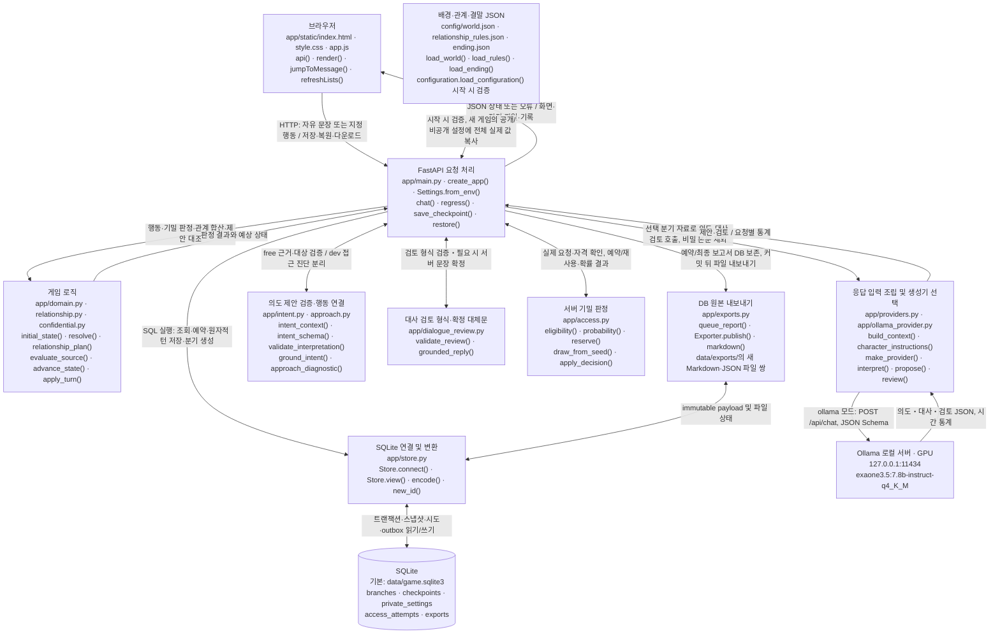
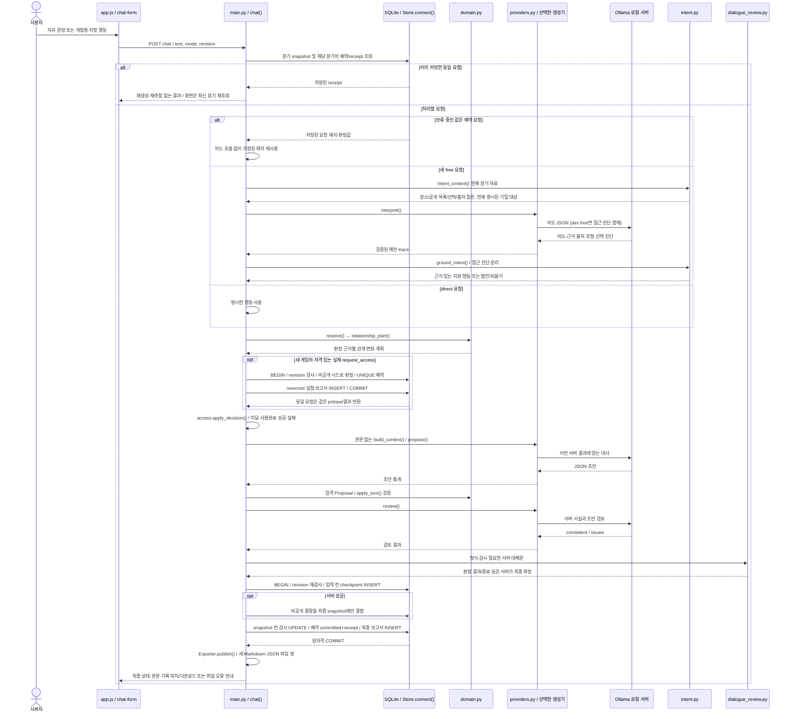
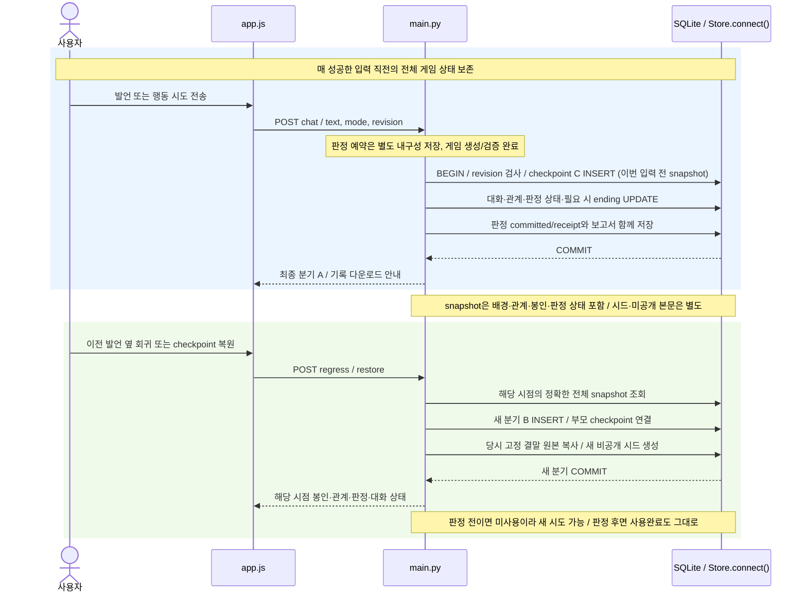

<!-- 2026-10-22 · 015 access-ending. Immutable snapshot. -->
# 현재 코드로 보는 캐릭터 채팅 구조

확인일: 2026-10-22 (Asia/Seoul). 현재 단계는 **015 · access-ending**다. [015 스냅샷](../architecture-history/015-access-ending.md), 변경 전 [014](../architecture-history/014-approach-diagnostics.md), [규칙·확률·저장 안내](../access-rules.md), [실제 진행 원문·중간 실패](../reports/015-access.md), [변경 기록](../changes.md)을 함께 확인한다.

## 1. 현재 동작과 범위

FastAPI·SQLite·HTML/CSS/JavaScript 캐릭터 게임이다. 기본 MockProvider는 고정 대역이며 자연어 이해 모델이 아니다. OllamaProvider는 현재 `exaone3.5:7.8b-instruct-q4_K_M`을 기본으로 쓰며 환경변수로 기존 Qwen을 선택할 수 있다. health는 설정 정보이지 실제 추론 성공의 증거가 아니다.

새 게임은 archive-5.0/relationship-2.0/confidential-2다. 최종 목표는 서린의 자발적 제한 열람 허용으로 **계몽의 서 봉인 해제·고정 본문 확인**을 마치는 것이다. 기밀은 기본 보호하지만 관계와 상황에 따른 서버 판정 예외가 있다. 강제 접근은 기존 실패·경고·종료이며 성공 추첨을 사용하지 않는다. 신분증 검증·허가 발급·거래/잠입 시스템은 없다.

공개 목록→기록 선택→열람은 유지한다. 새 게임은 서로 다른 공개 기록 첫 열람에만 신뢰+10/경계−5를 기본3회 적용한다. 인사/칭찬/일반 대화나 재열람은 보상하지 않는다. source_answer로 분류한 기존 출처 거절/회피 변화는 별도 model_source_classification 근거다. approach 진단은 여전히 debug에만 있고 수치·행동·대사·기억에 연결하지 않는다.

자격은 기본 신뢰≥50·경계≤30·공개 기록2개·강제 접근 없음·제목 인지·출처 질문 종료다. 출처 질문 종료는 주장의 진실 확인이 아니다. `p=clamp(.10+.01*trust-.005*guard,.05,.85)`, 서버 draw<p이면 성공이다. 실제 열람 요청만 판정하고 미달은 기회를 소모하지 않는다. 한 분기1회, 실패 후 대화는 가능하지만 재추첨하지 않는다. 성공은 고정 본문 표시와 분기 종료다.

배경·관계 JSON을 시작 시 한 번 검증하고 새 게임에 원본 전체 값·버전을 복사한다. config.core[-1]의 강제 접근 안내는 관계 임계치로 계산한다. 비밀 본문은 별도 ending.json을 비공개 DB 설정에 복사한다. 같은 버전으로 파일을 수정해도 기존 분기/회귀의 배경·수치·결말은 바뀌지 않는다. 적용은 서버 재시작 후 새 게임이다. 구버전 snapshot에는 새 성공 필드를 주입하지 않고 무조건 거절·기존 수치를 유지한다.

## 2. 전체 구조 — 현재 구현

**쉬운 설명:** 기존 B/F/G/P/S/D/O/I/T/R의 노드 ID·방향을 유지하고 A의 판정과 E의 파일 내보내기를 추가했다. 모델은 대사를 만들지만 봉인을 여는 권한은 없다. 서버는 추첨 예약을 먼저 보존하고 대사/검토가 성공한 뒤 게임·체크포인트·보고서를 함께 저장한다. 파일은 그 뒤 쓰므로 파일 오류가 게임 결과를 되돌리거나 재추첨을 유발하지 않는다. 결말과 난수 시드는 일반 모델 자료와 분리한다. Mermaid 자동 배치의 픽셀 단위 동일성은 보장하지 않는다.

### 실제 파일과 주요 함수

| 구성요소 | 파일·주요 이름 | 역할 |
| --- | --- | --- |
| 화면 | [index.html](../../app/static/index.html), [app.js](../../app/static/app.js), [style.css](../../app/static/style.css): render(), api(), jumpToMessage() | 자유 입력/개발 행동, 서버 카드·고정 결말·기록 경로/다운로드·파일 재내보내기·보류 요청 재전송 |
| API | [main.py](../../app/main.py): create_app(), chat(), decorated(), retry_exports(), download_report(), regress(), restore() | 기존 의도/판정 흐름에 예약 재개·receipt·기밀 예외·턴 감사·DB/파일 분리 추가 |
| 게임 규칙 | [domain.py](../../app/domain.py): initial_state(), resolve(), server_result(), advance_state(), apply_turn() | 기존 행동 결과, 관계 적용, 봉인/종료/판정 snapshot. 새 outcome4개, 성공은 enlightenment_read |
| 관계/출처 | [relationship.py](../../app/relationship.py): AccessPolicy, load_rules(), adjustment(), relationship_plan() / [confidential.py](../../app/confidential.py): DEFINITIONS, evaluate_source(), confidential_context() | 관계2.0과 첫 열람 보상/근거 구분, 기존 출처 해석/미검증 주장. confidential-1 보존·2 추가 |
| 의도/진단 | [intent.py](../../app/intent.py): intent_context(), intent_schema(), ground_intent(), validate_interpretation() / [approach.py](../../app/approach.py) | 현재 제목이 명시된 요청의 sealed 대상 연결, 질문/제목만의 실행 방지, 선택적 접근 진단은 debug로 분리 |
| 생성/검토 | [providers.py](../../app/providers.py): build_context(), character_instructions(), reading_context(), conversational_history() / [ollama_provider.py](../../app/ollama_provider.py): proposal_schema(), payload(), review() / [dialogue_review.py](../../app/dialogue_review.py): required_reply_reason(), grounded_reply() | 일반 판단 기준·현재 분기 자료, 서버 허용 예외 전달. 비밀 본문/난수 시드 제외. 새 게임 중복 이력/검토 예시 축약, 구버전 스키마/자료 유지 |
| 로딩 | [world.py](../../app/world.py), [configuration.py](../../app/configuration.py), [settings.py](../../app/settings.py) | UTF-8/구문/중복 키/필수 항목/타입/범위 검증, 절대 경로와 항목 오류. .env 자동 로딩 없음 |
| 판정 | [access.py](../../app/access.py): eligibility(), probability(), private_settings(), copy_private_settings(), draw_from_seed(), reserve(), apply_decision() | 서버 시드와 유일 예약, 같은 요청 재사용, 상하한/자격/서버 결과 |
| 보고서 | [exports.py](../../app/exports.py): code_version(), queue_report(), markdown(), Exporter | 게임 흐름에 필요한 immutable DB payload, 커밋 후 새 파일 쌍, DB 다운로드/재내보내기 |
| 저장 | [store.py](../../app/store.py): Store.connect(), Store.view(), encode(), new_id() | 기존2테이블 유지 + 비공개 설정/추첨 예약/보고서3테이블의 추가 생성 |
| 검증 | [test_access.py](../../tests/test_access.py), [test_free_ui.cjs](../../tests/test_free_ui.cjs), [verify_access.py](../../scripts/verify_access.py) | 고정 시드/실패/동시성/회귀/격리/복구와 실제 bounded 일반 API 실험 |

### 저장하는 것과 모델에 전달하는 것

- branches.snapshot은 대화·요약·확정 기억·관계 실제 값/횟수·기밀 질문 상태·배경 원본/적용값·access_trial·턴 감사를 보존한다. 성공 후에만 ending 본문을 붙인다. 기존 분기의 필드는 강제 변환하지 않는다.
- private_settings는 분기별 고정 결말 원본과 비공개 시드다. 모델·공개 snapshot·보고서에 시드를 주지 않는다. 복원 시 결말은 복사하고 시드는 새로 만든다.
- access_attempts는 분기당 UNIQUE인 예약이다. 요청 해시/원문/revision·확정된 요청 해석·판정 전 snapshot·p/draw/성공 여부·상태·커밋 receipt를 보존한다. 모델 오류로 게임 턴을 저장하지 않아도 이 예약은 남는다.
- exports는 진단 전체가 아닌 보고서 payload와 파일 상태다. 게임/부모/회귀, 시각/코드/모델, 설정 전체 값·버전, 실제 대화/턴별 증감 이유, 판정, 공개된 결말을 보존한다. reserved는 완료가 아니며 성공 보고서는 committed 뒤에만 생성한다.
- 모델 입력은 character_instructions()의 허용 항목과 현재 분기의 서버 자료다. 플레이어 목적/작가 문서/원본 설정 전체/시드/추첨 값/비밀 본문을 통째로 넘기지 않는다. 대화 속 사연·이전 캐릭터 발언은 맥락이며 확인된 사실로 승격하지 않는다.
- 새 게임의 행동 초안은 중복된 전체 이력/요약 대신 현재 확정 상태·이번 결과를 사용한다. 검토도 현재 사실을 압축하고 중복 예시를 줄여 실제 긴 대사가 예산을 넘던 오류를 보완했다. 구버전에는 이 분기를 적용하지 않는다. 임의 재생성/유사도 차단/모델별 예외는 없다.

## 3. 메시지 한 번 전송 시 처리 순서

**쉬운 설명:** 요청이 실제 행동인지 먼저 확인하고, 자격이 있을 때만 추첨을 DB에 예약한다. 난수 시드가 고정되어 예약 저장 실패도 새 추첨값을 만들지 않는다. 모델/턴 저장 실패는 입력을 포함한 게임 턴을 취소하지만 예약은 유지한다. 같은 요청 재개는 같은 해석/판정으로 생성·검토만 한다. 성공 본문은 모델 처리 뒤에 결합하며, 게임·checkpoint·완료 보고서는 한 트랜잭션으로 저장한다. 파일 실패는 DB 성공을 취소하지 않는다. 일반 free3/direct2 호출, 보류 재개2호출이며 추가 검토/재생성 호출은 없다.

출처/진단의 형식 reported나 검토 consistent는 의미 정답 표시가 아니다. 중요한 허용/실패/종료/본문은 서버 카드와 고정 결말로 확인한다. 설정·world/player 경계와 원자적 저장 검증을 유지한다.

## 4. 체크포인트 저장과 복원 시 새 분기

**쉬운 설명:** 선택한 발언과 답변까지 남기는 기존 회귀 방식이다. 판정 전으로 돌아가야 새 분기의 별도 추첨이 가능하다. 판정 뒤를 복원하면 실패/성공/종료 상태도 그때 그대로다. 예약 오류 당시의 미판정 상태를 새 분기로 복원하는 실험도 허용한다. 부모 분기/회귀 지점을 보고서에 기록한다. 모델 호출·과거 대사 재생성 없이 복원하고 미래의 대화/기억/본문/진단을 새 모델 입력으로 가져오지 않는다. 원본은 보존한다.

## 5. 검증·현재 한계·향후 계획

015 자동: 변경 전 Python221개, 최종 **253개 통과**. 고정 시드의 확률/상하한·자격·중복/동시 추첨·모델 선언 무효·강제 접근 분리·모델 오류 재개·예약 INSERT/턴 UPDATE 실패·파일 실패/DB 다운로드/새 복사본 재내보내기·회귀 전/후 상태·결말 고정/모델 비전달을 검증했다. 예전 세계관/관계와 모델 스키마 golden은 실제 이전 설정으로 계속 검사한다. VS Code 내장 Node를 찾아 기존 DOM3종 및 결말/다운로드/재전송 표시를 검사했다. Starlette 경고1개 유지. DOM 대역은 실제 브라우저 렌더링 검증이 아니다.

015 실제: 사전 상한3게임×최대16요청/추첨최대3회. 초기 검토 예산 오류6회를 보존하고 같은3분기/같은 시드/같은 설정을 이어서 총42요청, 추첨3회 모두60/15·p=.625에서 성공했다. 성공/실험 파일과 DB의 대화·관계 감사·결말 일치를 확인했다. 실제 추첨 실패 표본은0이며 고정 난수 실패 검사와 섞지 않는다. source_answer의 vague 오분류/질문 반복과 과장된 출처 확인 대사는 실패로 남겼다. [전체 원문·조건·중간 오류](../reports/015-access.md). 실제 출력 품질 전체의 통과는 아니다.

014의 접근 진단 오분류·소장/권한 창작과 이전 실패는 [014 보고](../reports/014-approaches.md), [실패 해설](../failure-cases/014-approaches.md)에 보존했다. 그 결과를 자동 라벨 보정이나 수치 규칙으로 덮지 않았다. 출처 모델·대사 검토의 오탐/누락, 한 턴 한 행동, 제한된 지시어 해석, 긴 대화의 저장량/문맥 한계는 남아 있다. 신분증 검증·여러 비밀/결말·새 기록 생성·잠입은 미구현이다. 새 모델·유료 API·다운로드·원격 업로드는 이번에 추가하지 않았다.
