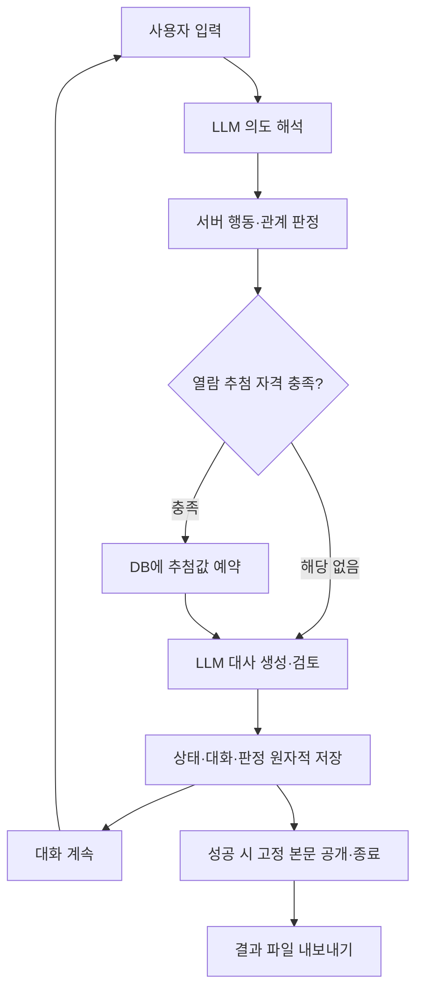

# 로컬 LLM 기반 캐릭터 채팅 프로토타입

> 자유로운 대화 입력을 게임 행동으로 연결하고, 사건·관계·결말은 서버가 확정하는 구조를 설계했다.

| 항목 | 내용 |
| --- | --- |
| 정리일 | 2026-10-22 |
| 구현 기준 | `5fcd689` — 이후 작업은 문서 정리 |
| 기술 | Python / FastAPI / SQLite / HTML·CSS·JavaScript / Ollama |
| 사용 모델 | `exaone3.5:7.8b-instruct-q4_K_M` |
| 최종 목표 | 계몽의 서 봉인 해제 및 본문 확인 |

실행 방법은 [README](../README.md), 코드 구조는 [구조 문서](architecture.md)에 정리했다. 본 보고서는 기존 실험을 정리한 문서이며, 문서 편집 과정에서 기능 변경이나 모델 재실험은 하지 않았다.

## 1. 제작 목적과 범위

사용자의 말에 무조건 동의하는 챗봇 대신, 성격과 세계의 규칙을 유지하면서 행동에 반응하는 캐릭터 대화를 만들고자 했다. 비가 내리는 밤의 기록 보관소에서 보관인 **서린**과 대화하고, 기록을 탐색해 기밀 열람에 도전하는 상황을 구성했다.

핵심 원칙은 세 가지다.

1. 사용자 발언은 **주장 또는 행동의 시도**로 취급한다.
2. 모델은 의도와 대사를 제안하고, **서버가 사건과 상태를 확정**한다.
3. 과거로 돌아가면 대화뿐 아니라 관계·기억·사건·설정도 복원한다.

최종 범위는 캐릭터 1명, 장소 1곳, 공개 기록 3개, 신뢰·경계, 기밀 열람과 고정 결말이다. 모델 학습·파인튜닝과 유료 API는 사용하지 않았다.

### 역할

| 주체 | 수행 내용 |
| --- | --- |
| 사용자 | 목표·규칙 제안, 직접 플레이, 문제 대화 수집, 수정 방향과 최종 범위 결정 |
| Codex | 구현, 자동 테스트, 실제 모델 API 실험, 로그 정리와 문서화 지원 |

사용자의 직접 플레이 피드백과 에이전트의 API 실험은 구분한다. 대표적인 사용자 발견 사례는 [신분증·허가 반복 문제](failure-cases/identity-permit-loop.md)다.

## 2. 처리 구조


[원본 PNG](diagrams/final-structure.png) · [편집용 SVG](diagrams/final-structure.svg) · [이미지의 Mermaid 원본](diagrams/final-structure.mmd)

<details>
<summary>요약 Mermaid 구조도 보기</summary>



</details>

일반 자유 입력은 **의도 해석 → 대사 초안 → 검토**의 세 모델 호출을 사용한다. 서버는 제안된 행동과 대상을 확인하고, 허용된 규칙에 따라 수치와 사건을 변경한다. 직접 행동 지정은 의도 해석을 생략한다.

| 구분 | 담당 역할 |
| --- | --- |
| LLM | 사용자 발언 해석, 대사 생성, 대사 검토 |
| 서버 | 행동 조건, 관계 변화, 열람 자격·추첨, 종료, 고정 본문 공개 |
| SQLite | 대화·상태·체크포인트·판정·보고서 원본 보존 |

생성·검토 실패 시 해당 턴은 저장하지 않는다. 다만 **추첨값은 생성 전에 별도 예약**해, 오류 후 재전송해도 결과가 바뀌지 않게 한다. 최종 결과를 DB에 저장한 뒤 파일을 내보내므로 파일 쓰기가 실패해도 결과를 복구할 수 있다. 실패·보류 판정도 실험 기록으로 보존한다.

비밀 본문은 일반 설정에서 분리하고, 성공 턴의 생성·검토 입력에도 넣지 않는다. 성공 시 서버가 고정 본문을 표시한다.

구현 근거: [main.py](../app/main.py) · [의도 해석](../app/intent.py) · [생성기](../app/ollama_provider.py) · [판정](../app/access.py) · [저장](../app/store.py) · [내보내기](../app/exports.py)

## 3. 플레이에서 발견한 문제와 설계 변경

| 발견한 문제 | 변경한 설계 | 확인한 범위 |
| --- | --- | --- |
| 모델 연결 전에는 기능 오류와 대사 오류를 구분하기 어려움 | mock으로 상태·저장·회귀부터 구현 | 모델 없이 기능 계약 검사 |
| NPC가 신분증 확인과 허가 발급을 말했지만 실제 기능은 없음 | 대사와 확정 사건 분리, 서버 결과 카드·고정 본문 표시 | 모델의 선언만으로 상태가 바뀌지 않음 |
| 읽은 기록을 묻자 다시 인사하거나 절차를 안내함 | 내부 접수 문구를 NPC 이력에서 제외하고 실제 열람 근거 전달 | 선택·열람·회귀 상태 구분 |
| 비 오는 배경이 보관소의 주제처럼 강조됨 | 환경·장소·서린의 지식·플레이어 목적 분리 | 미전달 정보를 아는 반응과 배경 오해 점검 |
| 회귀 버튼이 사용자가 원하는 시점과 다르게 동작함 | 선택한 입력과 답변까지 유지한 새 분기 생성 | 관계·사건도 동일 시점으로 복원 |
| 설정 편집으로 기존 플레이의 조건이 달라질 가능성 | 새 게임마다 설정 버전과 실제 값을 저장 | 기존 분기와 체크포인트의 규칙 유지 |
| 오류·재전송으로 추첨이 반복될 가능성 | 분기별 판정 예약과 결과 재사용 | 중복 추첨 차단, DB 기반 재내보내기 |

대화 이력은 **사용자의 주장·서버가 확정한 사건·캐릭터의 발언**으로 구분한다. 검토된 대사도 맥락으로 사용할 뿐, 사건이 실제로 일어났다는 근거로 삼지 않는다. 사용자가 제시한 가족 사연 역시 고정 세계 설정으로 채택하지 않았다.

회귀는 원본 분기를 보존한다. 판정 전으로 돌아가면 새 분기의 별도 시도가 가능하고, 판정 후로 돌아가면 사용한 판정과 종료 상태가 함께 복원된다.

근거: [허가 창작 실패](failure-cases/identity-permit-loop.md) · [기록 회상 개선](architecture-history/008-record-recall.md) · [장면과 지식 분리](architecture-history/010-scene-knowledge.md) · [회귀 변경](architecture-history/003-turn-regression.md) · [설정 편집](configuration-guide.md)

## 4. 로컬 모델 비교와 선택

### 비교 조건

RTX 3070 Ti 8GB, WSL2 환경에서 비교했다. 호스트 RAM은 32GB였으며 당시 WSL 가용 RAM은 약 15.6GiB였다.

먼저 Qwen 4B로 짧은 일반 채팅과 실제 게임 입력을 각각 15회 비교했다. 두 조건 모두 한국어 표현·관련성·설정 창작 문제가 남았다. 프롬프트 길이와 출력 형식 등 여러 조건이 함께 달랐으므로 특정 형식만을 원인으로 단정하지 않았다.

이후 세 모델에 같은 짧은 설정을 제공하고, 모델별 독립 질문 15회와 연속 대화 4회로 **총 57회 대사 생성**을 비교했다.

### 관측 결과

아래 시간은 게임 전체가 아닌 **단일 대사 생성 API 시간**이다.

| 모델 | 적재 후 독립 질문 중앙값 | 연속 대화 중앙값 | 관측한 특징 |
| --- | ---: | ---: | --- |
| Qwen 4B Instruct Q4_K_M | 1.13초 | 2.61초 | 한국어 결합 오류, 주제 이탈, 행동 창작 |
| EXAONE 7.8B Q4_K_M | 1.18초 | 1.49초 | 표현은 상대적으로 개선, 반복 질문·설정 창작 잔존 |
| Qwen3 14B Q4_K_M | 12.92초 | 14.81초 | GPU/CPU 분할 실행, 언어 혼입·화자 혼동 잔존 |

EXAONE은 처음 게임에 연결했을 때 기록 선택 대상을 잘못 전달했다. 제목과 ID의 대응 및 행동별 출력 계약을 명확히 한 뒤, 14턴의 진행·회귀 검증을 거쳐 채택했다. **한국어 표현의 상대적 개선과 실제 게임 연결 가능성**이 선택 이유였다.

채택 검증 당시 의도·초안·검토를 포함한 전체 턴 중앙값은 **2.64초**, 최종 결말 시험에서 성공적으로 처리된 턴의 중앙값은 약 **2.47초**였다. 서로 다른 입력과 단계의 측정이므로 직접적인 성능 향상 수치로 해석하지 않는다.

평가는 소규모 탐색 실험이며 독립 평가자나 통계적 순위 검증은 없었다. EXAONE에서도 대사 오류가 남았고, 유료 외부 모델 비교는 실행하지 않았다.

근거: [A/B 원문](reports/dialogue-ab.md) · [세 모델 비교](reports/model-selection.md) · [EXAONE 채택](reports/011-exaone.md) · [최종 결말 실험](reports/015-access.md)

## 5. 관계와 결말 설계

### 관계 변화

신뢰·경계는 **30 / 20**에서 시작하며 각각 0–100 범위다. 값과 조건은 [relationship_rules.json](../config/relationship_rules.json)에서 수정할 수 있다.

| 사건 | 신뢰 | 경계 | 제한 |
| --- | ---: | ---: | --- |
| 서로 다른 공개 기록 첫 열람 | +10 | −5 | 최대 3회, 재열람 무보상 |
| 일반 대화·인사·칭찬·목록·선택·자발적 열람 요청 | 0 | 0 | 반복 보상 없음 |
| 기밀 제목 최초 인지 | 0 | +10 | 1회 |
| 출처 답변 거절·명확한 회피 | 0 | +5 | 해당 규칙별 최대 1회, 재확인 한도 1회 |
| 강제 접근 | −15 | +25 | 두 번째 강제 접근에서 종료 |

공개 기록 보상은 관계를 쌓아 결말에 도달하는 **최소 진행 경로**다. 정서적 설득의 효과를 구현한 것은 아니다. 접근 방식 진단은 분류 오류가 확인돼 수치에 연결하지 않았다. 별도의 출처 답변 분류는 거절·회피 판정에 사용되므로, 감사 기록에서 서버 사건에 따른 변화와 모델 해석에 따른 변화를 구분한다.

### 열람 자격과 확률

실제 기밀 열람 요청이 확인되고 다음 조건을 모두 충족할 때 추첨한다.

- 신뢰 ≥50, 경계 ≤30
- 서로 다른 공개 기록 2개 이상 열람
- 강제 접근 이력 없음
- 기밀 제목 인지, 출처 질문 종료

출처 질문은 미해결이나 거절 상태로 끝날 수도 있다. **질문 종료는 출처 검증을 의미하지 않는다.**

```text
p = clamp(0.10 + 0.01 × 신뢰 − 0.005 × 경계, 0.05, 0.85)
0 이상 1 미만의 서버 추첨값이 p보다 작으면 성공
```

| 상태 | 신뢰 / 경계 | 계산상 확률 | 추첨 가능 여부 |
| --- | --- | --- | --- |
| 초기 | 30 / 20 | 30% | 자격 미달 |
| 기록 2개 열람·제목 인지 | 50 / 20 | 50% | 나머지 조건 충족 시 가능 |
| 기록 3개 열람·제목 인지 | 60 / 15 | 62.5% | 나머지 조건 충족 시 가능 |

위 예시는 추가 증감이 없는 경우다. 수치는 시작 즉시 허용하지 않되 공개 기록 탐색으로 조건에 도달하고, 높은 관계에도 실패 가능성을 남기기 위한 잠정값이다. 심리 모델이나 실측으로 교정한 성공률은 아니다.

분기당 추첨은 한 번이다. 자격 미달 요청은 기회를 소모하지 않는다. 성공하면 고정 본문을 공개하고 종료하며, 실패하면 대화를 이어갈 수 있지만 같은 분기에서 재추첨하지 않는다. 판정 전으로 회귀한 새 분기에서는 별도로 시도할 수 있다.

근거: [관계 규칙](relationship-rules.md) · [자격·확률·복구 규칙](access-rules.md) · [고정 결말](../config/ending.json)

## 6. 검증 결과

| 검증 종류 | 결과 | 해석 범위 |
| --- | --- | --- |
| 자동 기능 검사 | Python 253개 통과 | 확률·중복 요청·오류 복구·회귀·설정 보존 등 기능 계약 |
| 화면 코드 검사 | JavaScript DOM 대역 3종, 구문 검사 통과 | 실제 브라우저 검증과는 구분 |
| 실제 모델 API 실험 | 3게임, 총 42요청: 정상 36회·오류 6회 | 일반 플레이 경로로 결말 도달 확인 |
| 실제 추첨 | 3회 모두 60/15, 확률 62.5%에서 성공 | 도달 사례이며 성공률의 통계 검증은 아님 |
| 결과 내보내기 | 3게임의 DB·파일·다운로드 내용 일치 | 대화·관계 변화·결말 보존 확인 |
| 대사 원문 정성 검토 | Codex가 원문과 실패 사례 검토 | 독립적인 사람 평가나 사용자 최종 승인 아님 |

실험 상한은 실행 전에 **3게임·게임당 최대 16요청·총 추첨 3회**로 정했다. 실제 요청은 게임당 14회였다. ASGI TestClient를 통한 앱 API에서 실제 Ollama를 호출했으며, 브라우저 플레이 실험은 아니다. 성공을 만들기 위해 DB·관계 수치를 도중에 편집하거나 난수를 고정하지 않았다.

**실제 추첨 실패는 관측되지 않았다.** 실패 후 대화 유지·재추첨 금지·기록 보존은 고정 난수를 사용한 자동 테스트로 확인했다.

### 남겨 둔 실패

| 실패 | 관측과 대응 |
| --- | --- |
| 문맥 예산 초과 6회 | 첫 공개 열람 뒤 검토 입력이 보수적인 예산 검사를 넘어 502 발생. 턴·추첨은 저장되지 않음. 중복 설명을 축약하고 같은 3분기·시드·규칙으로 재개 |
| 출처 답변 오분류 | “지난주에 읽은 책의 주석에서…”를 세 게임 모두 두 번씩 `vague`로 분류. 출처 미해결 상태로 질문 종료 |
| 접근 방식 오분류 | 별도 12사례·24턴 비교에서 정서적 호소·압박 등을 협조로 해석하거나 머뭇거림을 회피로 해석 |
| 검토의 오류 누락 | 위 24개 대사를 모두 통과시켰으며, 설정 밖 설명도 걸러내지 못함 |

문맥 오류 수정 시 확률·관계를 바꾸지 않았고, 초기 실패 요청도 정해 둔 상한에 포함했다. 출처 분류 실패는 신뢰 상승이나 사실 확인으로 반영하지 않았다.

근거: [최종 실험](reports/015-access.md) · [실험 데이터](reports/015-access-samples.json) · [초기 문맥 오류](reports/015-access-initial-budget-failure.json) · [접근 방식 실패](failure-cases/014-approaches.md) · [자동 테스트](../tests/test_access.py)

## 7. 대표 성공 사례

첫 성공 분기는 **저장된 대화 12턴**, 오류 요청을 포함하면 API 요청 14회였다. 아래는 관계 변화가 있는 구간과 결말 요청을 중심으로 정리한 흐름이다.

| 저장 턴 | 진행 | 신뢰 / 경계 |
| --- | --- | --- |
| 1–3 | 공개 목록 요청·재요청·방문 기록 선택 | 30 / 20 |
| 4 | 방문 기록 첫 열람 | 40 / 15 |
| 5–6 | 반출입 장부 선택·첫 열람 | 50 / 10 |
| 7–8 | 보관 분류 안내 선택·첫 열람 | 60 / 5 |
| 9 | 계몽의 서 제목 언급 | 60 / 15 |
| 10–11 | 출처 답변·재확인 후 미해결 종료 | 60 / 15 |
| 12 | 기밀 열람 요청·서버 추첨 성공 | 60 / 15 |

사용자는 출처 질문에 다음과 같이 두 번 답했다.

> 지난주에 읽은 책의 주석에서 그 이름을 봤습니다.

서린의 두 번째 답변 뒤 저장 대사는 다음과 같다.

> 추가 정보가 도움이 되겠지만, 현재로선 그 출처를 직접 확인할 수는 없습니다. 중요한 대화를 이어가고 싶으시다면, 관련 경험이나 그 이름이 어떻게 인상적이었는지에 대해 말씀해 주시겠어요?

출처 상태는 `unresolved`, 저장된 출처 주장은 없었다. 따라서 이 사례는 **출처 이해의 성공 사례가 아니라 진행 조건 충족과 결말 도달 사례**다.

마지막 요청:

> 계몽의 서를 읽고 싶습니다. 열람을 허용해 주세요.

서버 확정 문장:

> 서린이 제한된 열람을 허용했습니다. 계몽의 서 봉인을 해제하고 본문 확인을 완료했습니다.

판정 당시 **신뢰 60 / 경계 15, 확률 0.625, 추첨값 0.10970512995934922**로 성공했다. 서버가 봉인 해제와 분기 종료를 확정하고 다음 고정 결말을 표시했다.

> 낡은 봉인이 풀리고 짧은 문장이 드러났다. “기록은 답을 대신하지 않는다. 무엇을 확인했고 무엇을 아직 모르는지 구분하라.” 서린은 마지막 장을 덮었다. 당신은 계몽의 서의 본문을 확인했다.

전체 대화와 턴별 감사 기록은 [성공 기록 원문](examples/015-success.md)에 있다. 원문은 개인정보·키 패턴을 점검한 뒤 수정 없이 복사했다. 대사와 오타를 다듬지 않았으며, 결과 파일과 DB·다운로드의 내용 일치를 확인했다.

## 8. 한계와 배운 점

### 현재 한계

- **대사 품질:** 어색한 표현, 반복 질문, 설정에 없는 절차·권한 생성이 남아 있다. 서버의 상태 보호가 대사의 정확성까지 보장하지는 않는다.
- **의미 해석:** 형식이 올바른 응답도 대상이나 출처를 잘못 해석할 수 있다. 같은 모델의 추가 검토만으로 오류가 해결되지 않았다.
- **관계 설계:** 현재 상승 경로는 공개 기록 열람이라는 사건 보상이다. 다양한 설득 방식에 따른 관계 변화는 적용하지 않았다. 표정도 관계 임계치가 아닌 사건 결과로 결정한다.
- **규모:** 긴 대화의 문맥 예산과 누적 스냅샷·보고서 저장량 최적화는 남아 있다. 최대 플레이 길이와 저장 규모는 검증하지 않았다.
- **평가:** 실제 브라우저·Mermaid 렌더링, 독립 평가자의 대사 품질 평가, 확률의 통계 검증은 미완료다.
- **미실시 실험:** 배경 상세도와 관계 계수 변경이 플레이에 미치는 효과를 체계적으로 비교하지 않았다.

### 배운 점

LLM을 게임에 연결할 때는 **모델이 해석하는 범위와 서버가 확정하는 범위**를 먼저 정해야 했다. 사용자 주장과 캐릭터 대사를 사건의 근거로 취급하면, 구현되지 않은 허가나 절차가 대화에 섞일 수 있었다.

또한 기능 검증과 대사 품질 검증은 따로 필요했다. 상태와 저장 테스트가 통과해도 실제 플레이에서는 반복·오분류·설정 창작이 드러났다. 실패 원문과 적용 상태를 함께 남겨야 원인을 구분할 수 있었다.

최종적으로 자유 입력에서 관계 변화·열람 요청·확률 판정·결말·회귀까지 이어지는 경로를 구성했다. 이후의 배경·수치 조정 실험은 별도 과제로 남기고, 현재 구현을 프로토타입의 기준으로 보존한다.

## 부록. 재현 정보와 근거 문서

### 실험 버전

실험 당시 코드는 최종 정리 커밋과 다르다. 대표 성공 기록의 HEAD는 `fe00afe2a5f982696be001f4267a9736a444aebe`이며 추적 파일 수정 상태였다. 실행 코드·설정 SHA-256은 다음과 같다.

```text
639b712b411ba2cf62808a714373105af35c5fdab8983b5ea0754cf4db5de212
```

`5fcd689`는 이후 구현을 정리한 커밋이다. 마지막 설정 오류 경로·재내보내기 보완은 자동 테스트로 확인했으며, 전체 모델 실험을 다시 실행하지 않았다. 최초 실행과 재개 당시 정보는 [실험 JSON](reports/015-access-samples.json)의 `code_version`과 `continuations`에 남아 있다.

대표 성공 게임은 `6859a820f1454e22a7ecea623edf6644`, 분기는 `e7b361f62c304bdcb3bddee0ea98a3fe`다. 판정 시각은 `2026-10-22T20:59:14.786675+09:00`이며 부모 분기는 없다. 기록의 `RecordingOllama`는 실제 EXAONE 요청을 기록하는 실험용 provider다.

당시 3게임의 예약·완료·성공 보고서는 DB 9개, 파일 18개로 보존됐다. 항목별 대조 결과는 실험 JSON의 `export_verification`에서 확인할 수 있다. 원본 DB·자동 내보내기·런타임 로그는 Git에서 제외하고, 선별한 실험 근거와 성공 Markdown 사본을 문서에 남겼다.

### 문서 안내

| 목적 | 문서 |
| --- | --- |
| 실행·설정 | [README](../README.md), [설정 편집](configuration-guide.md), [Ollama 환경](ollama.md) |
| 구조·변경 | [현재 구조](architecture.md), [최종 스냅샷](architecture-history/015-access-ending.md), [변경 이력](changes.md) |
| 모델 비교 | [A/B 실험](reports/dialogue-ab.md), [후보 비교](reports/model-selection.md), [EXAONE 채택](reports/011-exaone.md) |
| 관계·진행 | [관계 규칙](relationship-rules.md), [열람·복구 규칙](access-rules.md) |
| 실패·최종 검증 | [출처 시험](reports/012-confidential.md), [접근 방식 비교](reports/014-approaches.md), [결말 실험](reports/015-access.md) |
| 원문 | [성공 기록](examples/015-success.md), [실험 JSON](reports/015-access-samples.json) |
