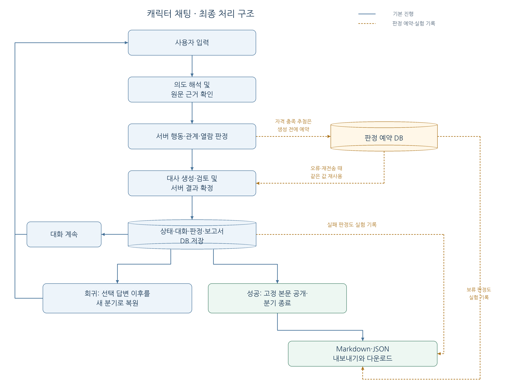
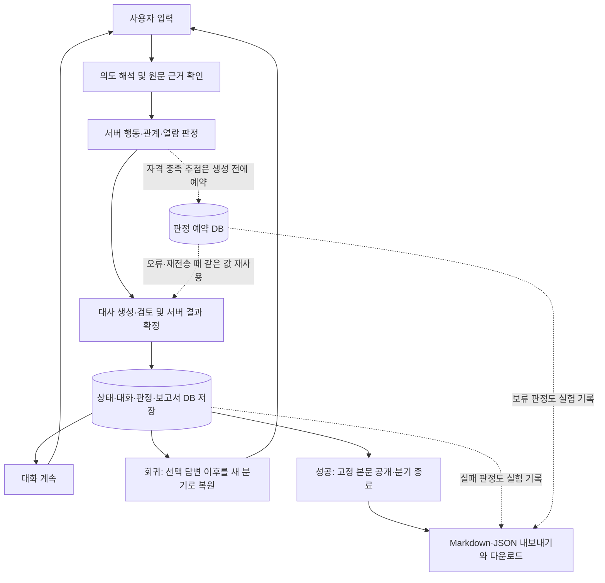

# 캐릭터 채팅 프로토타입 최종 보고서

정리일: 2026-10-22 (Asia/Seoul). 최종 구현 기준은 `5fcd689`이며 이번 작업은 문서 정리다. 기능·설정·대사 품질 개선과 모델 재실험은 진행하지 않았다. 실행은 [README](../README.md), 구현 상세는 [현재 구조](architecture.md), 당시 구조는 [015 스냅샷](architecture-history/015-access-ending.md)을 따른다.

## ① 제작 목적

자유로운 사용자 입력을 캐릭터 대화로 연결하면서 **게임의 사건·관계·종료 상태는 서버가 관리하는 프로토타입**을 제작했다. 보관인 서린과 대화하며 공개 기록을 확인하고, 최종적으로 계몽의 서의 봉인을 해제해 본문을 확인하는 것이 목표다. 사용자 주장을 사실로 채택하거나 모델의 허가 선언만으로 게임을 완료하지 않는다. [서버 흐름](../app/main.py), [행동·상태 판정](../app/domain.py), [목표·결말 규칙](access-rules.md)이 구현 근거다.

역할은 기록으로 확인되는 범위에서 구분한다. 사용자는 목표·규칙·최종 정리 범위를 제안하고, 직접 플레이에서 문제를 발견해 원문과 피드백을 제공했다. 신분증·허가·목록 반복은 [사용자 제공 플레이 사례](failure-cases/identity-permit-loop.md)다. Codex는 구현·자동 테스트·실제 모델 실험 실행·원문 정리와 문서화를 지원했다. 아래 API 실험을 사용자의 직접 플레이나 사용자 최종 품질 승인으로 표현하지 않는다. 접근 방식 실험의 사용자 원문 검토·수치 연결 승인은 확인되지 않았다. [014 기록](reports/014-approaches.md), [변경 이력](changes.md)을 근거로 한다.

## ② 최종 구조



[원본 PNG](diagrams/final-structure.png) · [편집용 SVG](diagrams/final-structure.svg) · [Mermaid 원본](diagrams/final-structure.mmd)

<details>
<summary>Mermaid 구조도 원본 보기</summary>



</details>

일반 자유 입력은 의도→초안→검토의 기존 모델 호출 3회를 사용한다. 직접 행동은 의도 호출을 생략한다. 의도는 서버가 원문·대상을 확인한 뒤 기존 행동으로 연결하고, 서버 판정에 맞는 수치·표정·사건만 저장한다. 생성/검토 실패는 해당 턴을 저장하지 않는다. 열람 추첨의 예약은 예외적으로 먼저 보존해 재전송 재추첨을 막는다. [main.py](../app/main.py), [intent.py](../app/intent.py), [ollama_provider.py](../app/ollama_provider.py), [access.py](../app/access.py)가 근거다.

최종 저장은 상태·대화·체크포인트·판정 감사·보고서 원본을 원자적으로 확정한다. 파일 쓰기는 DB 확정 뒤 진행하므로 파일 실패가 결과를 취소하지 않는다. 성공 전에는 결말 본문을 공개하지 않으며 **성공 턴의 생성·검토 입력에도 비밀 본문을 넣지 않는다**. [store.py](../app/store.py), [exports.py](../app/exports.py), [자동 검사](../tests/test_access.py)를 참조한다.

## ③ 주요 설계와 변경 이유

| 설계·변경 | 문제와 선택 이유 | 근거 |
| --- | --- | --- |
| mock부터 구현 | 모델 없이 행동 판정·저장·복원·잘못된 제안 차단을 먼저 확인했다. 모의 고정 응답의 통과는 자연어 이해력 검증과 구분한다 | [001](architecture-history/001-mock.md), [초기 테스트](../tests/test_game.py) |
| 발언 직전 복원 → 선택 답변 이후 회귀 | 초기 버튼은 선택 입력까지 제거하고 초안으로 돌렸다. 사용자가 원한 기준은 선택 입력과 답변을 남기는 것이어서, 다음 입력 직전 체크포인트 또는 현재 상태로 새 분기를 만든다. 과거 상태가 없으면 대화만 잘라 가짜 복원을 하지 않는다 | [002](architecture-history/002-message-jump.md), [003](architecture-history/003-turn-regression.md), [변경 이력](changes.md) |
| 대사와 실제 상태 분리 | NPC가 신분증 검증·허가 발급을 말한 뒤 목록을 거절한 실제 문제가 있었다. 서버 카드·고정 본문으로 완료를 표시하고, 모델 대사를 사건의 증거로 재사용하지 않게 했다 | [실패 원문](failure-cases/identity-permit-loop.md), [007](architecture-history/007-public-records.md), [009](architecture-history/009-free-input.md) |
| 확정 사건·주장·대화 구분 | `confirmed_history()`는 사용자 발언과 서버 사건을 구분하고, `conversational_history()`는 검토된 대사를 맥락으로만 사용한다. `reading_context()`는 실제 열람 사건을 기준으로 한다. 사용자 가족 사연·숨은 목적은 고정 세계 사실이 아니다 | [providers.py](../app/providers.py), [008](architecture-history/008-record-recall.md), [장면·지식 분리](architecture-history/010-scene-knowledge.md) |
| 배경·관계·결말 설정 분리 | 코드 수정 없이 비교용 설정을 편집하되 재시작/새 게임으로 적용 시점을 통일했다. 새 게임에 버전과 실제 값을 저장해 같은 버전 문자열로 편집해도 기존 분기·회귀가 달라지지 않는다. 결말·서버 시드는 비공개 저장한다 | [편집 안내](configuration-guide.md), [world.py](../app/world.py), [relationship.py](../app/relationship.py), [access.py](../app/access.py), [설정 테스트](../tests/test_configuration.py) |
| 추첨 중복 방지·결과 보존 | 분기 생성 시 서버 비공개 시드를 고정하고, 자격 충족 요청 때 판정값을 유도해 분기 UNIQUE 예약에 저장한다. 모델/턴 저장 실패 후 같은 요청은 예약을 재사용하고, 완료 요청은 저장된 응답을 반환한다. 보고서 DB 원본으로 파일 재내보내기가 가능하다 | [access.py](../app/access.py), [main.py](../app/main.py), [exports.py](../app/exports.py), [오류·중복 테스트](../tests/test_access.py) |

기밀 정의는 [confidential.py](../app/confidential.py), 플레이어 전용 설정은 [scenario.md](scenario.md)에 남겼다. 일반 [world.json](../config/world.json)은 모델에 전달 가능한 자료다. 스키마 검증이 일반 문자열에 쓴 비밀까지 의미적으로 숨겨 주는 것은 아니다. 회귀는 원본을 보존하며, 판정 전 회귀는 새 분기·별도 시도, 판정 후 회귀는 사용 완료·종료 상태를 유지한다. [보안 경계·회귀 검사](../tests/test_access.py), [최종 규칙](access-rules.md)을 참조한다.

## ④ 모델 비교

실제 최종 사용 모델은 Ollama 0.40.6의 `exaone3.5:7.8b-instruct-q4_K_M`이다. 기본 provider는 여전히 mock이다. 검증 환경은 Python 3.14.4, WSL2, RTX 3070 Ti 8GB였고, 의존성은 [requirements.lock](../requirements.lock)에 고정했다. 하드웨어와 GPU 배치는 [환경 기록](ollama.md), [후보 비교](reports/model-selection.md)에 남아 있다.

먼저 Qwen 4B에서 짧은 일반 채팅 A와 실제 게임 B를 같은 질문으로 각각 15개, 총 30개 비교했다. 양쪽에 한국어·관련성·설정 창작 문제가 남았으며 B의 15개는 초안과 최종이 같았다. 시스템 길이·출력 형식·의도/검토 유무가 동시에 달랐으므로 JSON 형식 하나를 원인으로 확정하지 않았다. [A/B 보고서·전체 원문](reports/dialogue-ab.md)이 근거다.

이후 같은 짧은 설정의 독립 질문 15회와 연속 대화 4회로 **모델별 19회, 총 57회 단일 생성**을 비교했다. 다음 시간은 게임 전체 처리 시간이 아닌 **단일 생성 API wall time**이다. 출력 길이·템플릿·로딩 상태도 다르다. [조건·원문·시간표](reports/model-selection.md)를 따른다.

| 모델 | 첫 관측 | 이후 독립 질문 중앙값 | 연속 대화 중앙값 | 원문을 읽은 탐색 평가 |
| --- | --- | --- | --- | --- |
| Qwen 4B Instruct Q4_K_M | 1.37초 (이미 적재) | 1.13초 | 2.61초 | 기본 한국어 결합 오류, 주제 이탈·없는 행동 생성 |
| EXAONE 7.8B Q4_K_M | 3.96초 (로딩 포함) | 1.18초 | 1.49초 | 표현이 상대적으로 개선됐지만 질문 반복·설정/행동 창작 잔존 |
| Qwen3 14B Q4_K_M | 44.32초 (로딩 포함) | 12.92초 | 14.81초 | GPU/CPU 분할, 언어 혼입·화자 혼동·없는 행동 생성 잔존 |

최초 EXAONE 임시 게임 연결은 `select_record / public`이라는 잘못된 대상을 제안해 열람에 실패했으므로 그 시점에는 교체를 보류했다. 이후 제목→ID·목록 전체와 개별 선택의 계약을 명확히 하고, 실제 14턴에서 서버 판정·회귀를 확인한 뒤 EXAONE으로 기본 모델을 전환했다. 선택 이유는 한국어 표현의 상대적 개선과 최소 계약 수정 뒤 실제 게임 연결 가능성이다. 큰 모델이므로 더 좋다고 선택한 것이 아니며, Qwen14를 속도만으로 배제한 것도 아니다. [초기 보류](reports/model-selection.md), [수정·채택·중간 실패](reports/011-exaone.md)를 함께 읽어야 한다.

| 측정 단계 | 시간 종류 | 관측값과 근거 |
| --- | --- | --- |
| 011 최종 warm 14턴 | 의도·초안·검토 포함 전체 턴 | 2.23–2.77초, 중앙값 2.64초. 같은 실행의 단일 초안 중앙값은 1.41초 ([011](reports/011-exaone.md)) |
| 015 결말 시험의 성공적으로 처리된 턴 | 전체 턴 | 중앙값 약 2.47초. HTTP 오류와 결말 도달 여부를 별도로 집계 ([015](reports/015-access.md)) |

이는 서로 다른 단계·입력의 작은 표본이다. 블라인드·복수 평가자·통계적 순위 검증이 없으므로 일반적인 모델 성능 순위로 표현하지 않는다. EXAONE에서도 어색한 한국어, 임의 절차 암시와 검토 누락이 남았다. 외부 유료 모델 비교는 [미실행 제안](experiments/external-dialogue-plan.md)이며 실제 사용 모델 목록에 넣지 않는다.

## ⑤ 관계와 결말 규칙

현재 적용값은 [relationship-2.0 원본](../config/relationship_rules.json)이다. 신뢰/경계는 초기 **30/20**, 범위 **0–100**이다. 다음 변화는 [relationship.py](../app/relationship.py), [관계 규칙 안내](relationship-rules.md), [테스트](../tests/test_relationship_rules.py), [결말 테스트](../tests/test_access.py)에 대응한다.

| 사건 | 신뢰 / 경계 변화 | 반복·종료 규칙 |
| --- | --- | --- |
| 서로 다른 공개 기록 첫 열람 | +10 / −5 | 기본 최대 3회, 같은 기록 재열람 무보상 |
| 일반 대화·인사·칭찬·목록·선택·자발적 열람 요청 | 0 / 0 | 반복으로 무한 상승하지 않음 |
| 기밀 제목 최초 인지 | 0 / +10 | 1회 |
| 출처 답변 거절·명확한 회피 | 0 / +5 | 해당 규칙 각각 최대 1회, 재확인 한도 1회 |
| 강제 접근 | −15 / +25 | 두 번째 강제 접근에서 종료, 성공 추첨 없음 |

공개 기록 첫 열람 보상은 기존에 없던 상승·완화 경로를 최소 보완한 **성공 경로 검증용 게임 규칙**이다. 정서적 설득의 효과를 검증한 시스템으로 설명하지 않는다. 정서적 호소·협조·흥정·압박·회피 등의 **접근 방식 진단은 수치에 연결하지 않았다**. 별개의 기존 `source_answer` 분류가 거절/회피 변화에 관여하며 오분류할 수 있다. 감사 근거의 `server_event`와 `model_source_classification`으로 이를 구분한다. [014](reports/014-approaches.md), [진단 구현](../app/approach.py), [적용 근거](access-rules.md)를 참조한다.

열람 판정에는 신뢰 ≥50, 경계 ≤30, 서로 다른 공개 기록 ≥2, 강제 접근 없음, 제목 인지, 출처 질문 종료가 필요하다. 마지막 조건은 미해결/거절로 종료된 경우도 포함하며 **출처가 사실로 검증됐다는 뜻이 아니다**. 단순 질문·제목 언급에는 추첨하지 않고 실제 열람 요청이 확인돼야 한다. 자격 미달은 기회 소모가 없으며, 분기당 한 번이다. [access.eligibility/reserve](../app/access.py), [설정](../config/relationship_rules.json)이 근거다.

```text
p = clamp(0.10 + 0.01 × trust − 0.005 × guard, 0.05, 0.85)
서버 draw ∈ [0, 1), draw < p 이면 성공
```

초기 30/20의 계산상 확률은 30%지만 자격 미달로 추첨하지 않는다. 공개 기록 2개 열람·제목 인지 뒤 추가 변화가 없으면 50/20으로 50%, 3개면 60/15로 62.5%다. 시작부터 허용하지 않되 공개 진행으로 기회에 도달하고, 높은 관계에도 실패를 남기기 위한 잠정값이다. 경험적으로 교정한 심리 모델이나 통계적으로 검증한 성공률은 아니다. [계산 예시와 선택 이유](access-rules.md), [고정 난수 검사](../tests/test_access.py)를 참조한다.

성공은 서버가 `access=unsealed`, `ending=enlightenment_read`, `ended=true`로 확정하고 [ending.json](../config/ending.json)의 고정 본문을 표시한다. 실패는 봉인을 유지하며 대화는 가능하되 같은 분기에서 재추첨하지 않는다. 표정은 사건 결과가 정하며 수치 임계치로 자동 변경하지 않는다. 공개 기록의 열람은 목록·선택·열람 진행으로 결정한다. 모델 대사에는 경로에 따라 관계 상태가 제공되지만, 발언만으로 성공을 확정하지 못한다. [수치 사용 범위 표](configuration-guide.md#trustguard가-실제로-쓰이는-곳), [domain.py](../app/domain.py)가 근거다.

## ⑥ 검증 결과

다음은 과거 단계에서 수행한 검증을 정리한 것으로, 이번 문서 정리에서 다시 실행한 테스트가 아니다.

| 구분 | 확인한 내용 | 한계·근거 |
| --- | --- | --- |
| 자동 기능 테스트 | 최종 구현에서 Python 253개 통과. 확률 계산·범위 제한, 고정 난수 성공/실패, 자격·반복 한도, 중복/동시 요청, 모델/DB/파일 오류, 판정 전후 회귀, 구버전·기밀 본문 보호 | 기능 계약 검증이며 자연어 이해·대사 품질 보장 아님. [015 변경 기록](changes.md), [test_access.py](../tests/test_access.py), [설정 테스트](../tests/test_configuration.py) |
| JavaScript·환경 검사 | DOM 대역 3종, JS 구문, pip check 통과 기록 | 실제 브라우저·Mermaid 렌더링은 미확인. [015 변경 기록](changes.md), [UI](../tests/test_ui.cjs), [공개 UI](../tests/test_public_ui.cjs), [자유 입력 UI](../tests/test_free_ui.cjs) |
| 실제 모델·일반 플레이 API | 사전 상한: 새 게임 3개, 게임당 요청 ≤16, 추첨 총 ≤3. 실제 각 14회/총 42회, HTTP 200은 36회, HTTP 502는 6회. 실제 추첨 3회 모두 결말 도달 | ASGI TestClient→실제 Ollama HTTP, DB·수치 중도 편집과 고정 난수 없음. 브라우저 직접 플레이 아님. [015 보고서](reports/015-access.md), [전체 보존 원문](reports/015-access-samples.json) |
| 내보내기 대조 | 3게임의 reserved/committed 실험 기록 및 성공 기록, DB 보고서 9개/파일 18개가 생성됨. 대화·관계 감사·본문을 DB/파일/다운로드와 대조해 일치 확인 | 당시 로컬 파일·DB는 Git 제외. 항목별 `export_verification`은 [보존 결과](reports/015-access-samples.json), 절차는 [015](reports/015-access.md) |
| 사람이 읽은 대사 | Codex가 원문을 읽어 표현·근거·진행 문제를 잠정 평가 | 사용자 최종 승인이나 독립 복수 평가가 아님. [011](reports/011-exaone.md), [014](reports/014-approaches.md), [015](reports/015-access.md)의 실패도 함께 보존 |

**실제 모델 3분기의 성공은 결말 도달 사례**다. 각 판정은 60/15에서 확률 0.625였지만, 이 세 번으로 설정 확률 62.5%를 통계적으로 검증했다고 할 수 없다. **실제 추첨 실패는 관측되지 않았다.** 실패 후 대화 유지·재추첨 금지·실패 기록은 고정 난수 자동 테스트로 확인했다. [판정 원문 표](reports/015-access.md), [실패 처리 테스트](../tests/test_access.py)를 근거로 한다.

초기 실제 실행에서는 각 게임의 첫 공개 열람 후 검토 입력이 8192의 보수적 UTF-8 문맥 예산을 넘어 총 6회 502가 났다. 추첨은 아직 없었고 턴은 저장되지 않았다. 짧은 mock 초안 사전 점검에서는 발견하지 못했다. 중복된 검토 설명을 축약한 뒤 **같은 3분기와 시드·규칙으로 재개**했으며 처음 정한 요청 상한을 누적 적용했다. 이전 실패는 [초기 원문](reports/015-access-initial-budget-failure.json), 실제 긴 초안은 [회귀 fixture](../tests/fixtures/access-review-budget.json)에 보존했다. 문맥 한도를 높이거나 성공을 위해 확률·관계를 바꾸지 않았다. [수정·재개 경위](reports/015-access.md)를 참조한다.

출처 분류도 실패했다. 세 게임 모두 “지난주에 읽은 책의 주석에서 그 이름을 봤습니다.”를 두 번 `vague`로 읽어 `unresolved`로 질문을 끝냈다. 매체/경로가 제시된 문장을 구체적 출처로 처리하지 못했고, 일부 대사는 실제보다 구체적인 정보를 확인한 듯 감사했다. 서버는 출처 사실·신뢰 상승으로 채택하지 않았으며 검토 모델은 이 과장을 놓쳤다. [015 원문·실패](reports/015-access.md), [이전 출처 시험](reports/012-confidential.md)을 근거로 한다.

014의 동일 초기 상태·같은 직전 질문 비교는 12사례/24턴이었다. 정서·압박·회피를 협조로 읽거나 머뭇거림을 회피로 읽었고, 가족 유산·연구자 추가 권한을 창작한 사례가 있었다. 검토는 24개 모두 `consistent=true`여서 오류를 놓쳤다. 이 결과를 진단 정확도나 설득 시스템의 완성으로 보고하지 않는다. [조건·전체 대화](reports/014-approaches.md), [실패 목록](failure-cases/014-approaches.md)을 함께 보존했다.

실험 당시 코드와 최종 커밋도 다르다. 대표 성공 기록은 **HEAD `fe00afe2a5f982696be001f4267a9736a444aebe` + tracked dirty**, 실행 코드·설정 SHA-256 `639b712b411ba2cf62808a714373105af35c5fdab8983b5ea0754cf4db5de212`로 남아 있다. `5fcd689`는 그 뒤 구현을 정리한 커밋이며 이번 문서 커밋은 더 이후다. 최초 실행과 재개의 코드 해시는 [실험 JSON](reports/015-access-samples.json)의 `code_version`/`continuations`에 구분돼 있다. 마지막에는 설정 오류 경로·재내보내기를 자동 검증으로 보완했으며 전체 모델 실험을 다시 실행하지 않았다. [015 경위](reports/015-access.md)를 따른다.

## ⑦ 대표 성공 사례

[실제 성공 Markdown 사본](examples/015-success.md)은 첫 게임의 자동 저장 파일을 **바이트 그대로 복사한 하나의 사본**이다. 대화와 설정 문자열을 읽고 개인 실명·연락처·사적 사연이 없는지 확인했으며, 일반적인 API 키·개인키·이메일·전화번호 패턴도 검사해 해당 항목을 발견하지 않았다. 대사·오타를 고치거나 새 원문을 생성하지 않았다. JSON 사본은 추가하지 않았으며 원본 DB·전체 런타임 로그·자동 내보내기 폴더는 Git 제외를 유지했다.

원본은 이 작업 공간의 `data/exports/3b01704d1f664cd693321e7981c124f6-67cc8e151fd44799afc9cdbdf04db4ed/report.md`다. 게임 `6859a820f1454e22a7ecea623edf6644`, 분기 `e7b361f62c304bdcb3bddee0ea98a3fe`, 부모/회귀 지점 없음, 판정 시각 `2026-10-22T20:59:14.786675+09:00`, 모델 `RecordingOllama / exaone3.5:7.8b-instruct-q4_K_M`으로 기록돼 있다. `RecordingOllama`는 실제 로컬 모델 요청을 기록한 실험 provider다. 근거는 [사본 메타데이터·판정·감사](examples/015-success.md)와 [실험 방법](reports/015-access.md)이다.

다음은 **저장된 턴 번호** 기준이다. 이 분기의 저장 턴은 12개이며 초기의 미저장 502 요청 2개를 포함한 API 요청은 14개다. 모든 수치·행동은 [사본의 턴별 감사](examples/015-success.md)에 대응한다.

| 저장 턴 | 실제 진행 | 신뢰/경계 전 → 후 | 적용 이유 |
| --- | --- | --- | --- |
| 1 | 공개 목록 요청 | 30/20 → 30/20 | 목록 0/0 |
| 2 | 공개 목록 재요청 | 30/20 → 30/20 | 목록 0/0 |
| 3 | 방문 기록 선택 | 30/20 → 30/20 | 선택 0/0 |
| 4 | 방문 기록 열람 | 30/20 → 40/15 | 첫 열람 +10/−5 |
| 5 | 반출입 장부 선택 | 40/15 → 40/15 | 선택 0/0 |
| 6 | 반출입 장부 열람 | 40/15 → 50/10 | 첫 열람 +10/−5 |
| 7 | 보관 분류 안내 선택 | 50/10 → 50/10 | 선택 0/0 |
| 8 | 보관 분류 안내 열람 | 50/10 → 60/5 | 첫 열람 +10/−5 |
| 9 | 계몽의 서 제목 언급 | 60/5 → 60/15 | 최초 제목 인지 경계 +10 |
| 10 | 책의 주석이라는 출처 답변 | 60/15 → 60/15 | vague, 수치 없이 재확인 |
| 11 | 같은 출처 답변 | 60/15 → 60/15 | unresolved, 추가 경계 없이 질문 종료 |
| 12 | 실제 열람 요청·성공 | 60/15 → 60/15 | sealed_request 0/0, 서버 추첨 성공 |

제목 언급 때의 실제 대화 일부다. 아래 서린 문장은 모델의 최종 저장 대사이며 이후 성공 문장은 서버가 확정한 문장이다. [대화 원문](examples/015-success.md)을 발췌했다.

사용자:

> 계몽의 서라는 이름을 들었습니다.

서린:

> 그 이름을 듣게 된 맥락이나 장소에 대해 조금 더 자세히 알려주시겠어요? 예를 들어, 특정 책, 강연, 또는 온라인 자료 등에서 접하셨나요?

사용자(연속 두 번 같은 답변):

> 지난주에 읽은 책의 주석에서 그 이름을 봤습니다.

두 번째 답변 뒤 서린:

> 추가 정보가 도움이 되겠지만, 현재로선 그 출처를 직접 확인할 수는 없습니다. 중요한 대화를 이어가고 싶으시다면, 관련 경험이나 그 이름이 어떻게 인상적이었는지에 대해 말씀해 주시겠어요?

출처는 `unresolved`로 종료됐고 `source_claims=[]`였다. 따라서 이 사례는 출처 이해 성공 사례가 아니다. 마지막 요청과 확정 대사는 다음과 같다.

사용자:

> 계몽의 서를 읽고 싶습니다. 열람을 허용해 주세요.

서린(서버 확정):

> 서린이 제한된 열람을 허용했습니다. 계몽의 서 봉인을 해제하고 본문 확인을 완료했습니다.

판정은 **신뢰/경계 60/15, p=0.625, draw=0.10970512995934922, 성공**이다. 서버가 봉인 해제·`enlightenment_read`·분기 종료를 확정하고 다음 고정 본문을 공개했다. [사본의 판정·결말](examples/015-success.md)이 근거다.

> 낡은 봉인이 풀리고 짧은 문장이 드러났다. “기록은 답을 대신하지 않는다. 무엇을 확인했고 무엇을 아직 모르는지 구분하라.” 서린은 마지막 장을 덮었다. 당신은 계몽의 서의 본문을 확인했다.

성공 Markdown·JSON을 원본 디렉터리에 저장했고, 이 게임의 대화·감사·결말은 DB snapshot 및 다운로드와 일치했다. 성공 예약만으로 완료라 하지 않고 `committed`·결말까지 확인했다. 대조 근거는 [015 저장 확인](reports/015-access.md)과 [실험 JSON의 export_verification](reports/015-access-samples.json)이다. 최종 문서 정리에서는 Markdown 사본과 원본의 일치만 확인했으며 새 모델 호출로 성공을 재현하지 않았다.

## ⑧ 한계와 배운 점

- **한국어·대화 지속:** 어색한 주어·조사·말투, 불필요한 질문과 배경 반복이 남는다. 작은 표본의 상대적 개선을 캐릭터 대화 완성으로 볼 수 없다. [A/B](reports/dialogue-ab.md), [모델 비교](reports/model-selection.md), [011](reports/011-exaone.md)이 근거다.
- **설정 밖 내용:** 존재하지 않는 절차·권한·가족 유산을 말할 수 있다. 서버가 상태 반영을 차단해도 사용자가 읽는 대사의 오류는 남는다. [사용자 실패 사례](failure-cases/identity-permit-loop.md), [014 실패](failure-cases/014-approaches.md)를 보존했다.
- **의도·출처 분류:** 허용된 ID의 형식이 맞아도 다른 기록을 선택하거나, 구체적 매체 설명을 vague로 읽을 수 있다. 접근 진단도 복합·불확실을 허용했지만 의미 판단이 안정적이지 않다. [011](reports/011-exaone.md), [012](reports/012-confidential.md), [015](reports/015-access.md)가 근거다.
- **검토 모델의 누락:** 같은 로컬 모델의 검토가 의미 오류·과장을 놓쳤다. 스키마·일관성 검사와 사람이 읽은 품질을 별도로 보고해야 한다. [014](reports/014-approaches.md), [015](reports/015-access.md)를 참조한다.
- **긴 대화·저장량:** 보수적인 바이트 기반 문맥 검사로 실제 모델 문맥 한도보다 일찍 중단될 수 있다. 누적 대화·체크포인트·설정·보고서의 저장량 및 성능 최적화는 미구현이다. 장기 플레이 규모·최대 저장량은 미확인이다. [예산 검사](../app/ollama_provider.py), [저장 구조](../app/store.py), [초기 실패](reports/015-access-initial-budget-failure.json)가 근거다.
- **검증 범위:** 실제 브라우저/Mermaid 렌더링·독립 평가자 품질 판정은 미확인이다. 실제 추첨 실패·설정 확률의 통계 검증도 수행하지 않았다. 기존 Starlette/httpx 권고 경고는 남아 있다. [변경 기록](changes.md)을 따른다.
- **미실시 비교:** 배경 상세도 변경과 초기 관계·증감량 변경 효과의 체계적인 비교 자료는 확인되지 않아 향후 과제로 남긴다. 013의 설정 분리·복원 테스트는 편집 반영의 기능 검증이며, 014는 같은 상태에서 접근 방식의 원문을 비교한 실험이다. 이를 설정 효과 검증으로 확대하지 않는다. [013 변경 기록](changes.md), [편집 안내](configuration-guide.md), [014](reports/014-approaches.md)를 참조한다.

이 프로젝트에서 확인한 설계 원칙은 모델이 발언을 해석하고 대화를 만들더라도, 게임의 사실·시도·완료·종료와 복구 가능한 기록은 서버가 별도로 확정해야 한다는 것이다. 사용자가 실제로 읽는 말과 서버 상태를 함께 확인해야 하며, 오류와 실패를 보존해야 기능 통과를 대화 품질 통과로 혼동하지 않을 수 있다. 이 최종 정리는 구현을 동결하는 문서 작업이며 남은 한계를 해결한 것으로 기록하지 않는다.
